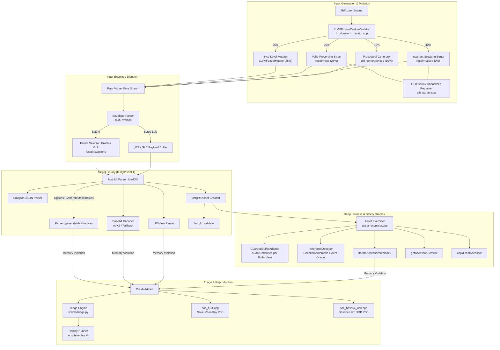

# fastgltf Structure-Aware Fuzzing Project (`src/`)

This directory contains the complete source code, mutation engines, safety oracles, fuzzing harnesses, automation scripts, raw experimental evaluation data, and vulnerability reproducers for the **fastgltf** fuzzing term project.

---

## 1. Project Metadata & Pinned Environment

All empirical results, coverage measurements, and vulnerability findings were generated using this pinned environment:

| Property | Value |
| :--- | :--- |
| **Target Library** | [fastgltf](https://github.com/spnda/fastgltf) |
| **Pinned Release** | `v0.9.1` |
| **Git Commit** | `705564d4d54500ae88befb0db9e361e447923655` (clean Git submodule in `external/fastgltf`) |
| **Target Architecture** | x86_64-pc-linux-gnu |
| **Operating System** | Linux 6.6 under WSL2 Ubuntu 24.04 LTS (Noble) |
| **Compiler Suite** | Clang version 18.1.3 (`clang`, `clang++`, `llvm-profdata`, `llvm-cov`) |
| **C++ Standard** | C++17 (`-std=c++17`) |
| **Build System** | CMake 3.28.3, Ninja 1.11.1 |
| **Fuzzing Engine** | LLVM libFuzzer |
| **Sanitizers** | AddressSanitizer (ASan) + UndefinedBehaviorSanitizer (UBSan) |

---

## 2. Research Hypothesis & Core Objectives

> **Under a constrained fuzzing budget (30 minutes per trial), can a target-specific, structure-aware glTF/GLB mutation engine penetrate deeper parser behavior, achieve higher branch coverage, and discover critical memory safety vulnerabilities compared to standard coverage-guided byte-level mutation?**

### Key Evaluation Arms:
1. **`byte` (Baseline):** Standard libFuzzer mutation (`LLVMFuzzerMutate`).
2. **`struct`:** Pure structure-aware mutation on JSON AST and GLB container chunks.
3. **`hybrid`:** 4-way stochastic mix combining byte-level fallback, valid-preserving structural mutation, invariant-breaking mutations, and procedural seed synthesis.

---

## 3. Project Architecture

The architecture decouples container parsing, JSON AST mutation, configuration profiling, and downstream accessor traversal into modular layers:



### Target Hierarchy:
- **`deep_fuzzer` (`fuzz/deep_fuzzer.cpp`):** Primary target. Decodes envelope profile byte, calls `Parser::loadGltf()`, and executes deep accessor traversal and metamorphic checking.
- **`parser_fuzzer` (`fuzz/parser_fuzzer.cpp`):** Baseline target. Evaluates pure parser throughput without downstream accessor traversal.
- **`uri_fuzzer` (`fuzz/uri_fuzzer.cpp`):** Micro-target focusing on `fastgltf::URIView` RFC parsing, authorities, and percent-decoding.
- **`base64_fuzzer` (`fuzz/base64_fuzzer.cpp`):** Micro-target evaluating AVX2 SIMD vs fallback base64 decoders.
- **`coverage_runner` (`fuzz/coverage_runner.cpp`):** Non-fuzzing harness replaying corpus files for strict Clang source coverage mapping.

---

## 4. Directory Structure

```
src/
├── CMakeLists.txt                       # Root CMake build definition with sanitizer flags
├── README.md                            # This file: architecture, run steps, and reproducibility
├── FUZZER_PROJECT_TECHNICAL_DOSSIER.md  # Comprehensive 72KB evidence-driven audit dossier
├── cmake/
│   └── coverage_allowlist.txt           # Restricts Clang coverage strictly to fastgltf & simdjson
├── corpus/
│   ├── gltf.dict                        # glTF 2.0 JSON dictionary for libFuzzer
│   ├── seed/                            # 43 base glTF and binary GLB seed files
│   └── generated/                       # Procedurally synthesized seed assets
├── docs/                                # Technical design documents
│   ├── accessor-preconditions.md        # Analysis of fastgltf accessor contract boundaries
│   ├── architecture.md                  # Harness and oracle architectural specification
│   ├── campaign_results.md              # Empirical campaign analysis and audit
│   ├── experiments.md                   # Experimental protocol and hypothesis design
│   ├── known_findings.md                # Known upstream issue classifications (Issue #144, #157)
│   └── mutations.md                     # Mutation strategies and boundary values specification
├── external/
│   └── fastgltf/                        # Git submodule pinned to upstream v0.9.1 (commit 705564d)
├── findings/                            # Campaign output, raw logs, and vulnerability reports
│   ├── index.csv                        # Primary triage catalog of unique crash root causes
│   ├── index_old.csv                    # Historical triage index documenting dedup template artifact
│   ├── crashes/                         # Raw crash artifacts captured by libFuzzer
│   ├── minimized/                       # libFuzzer-minimized crash reproducers
│   ├── known/                           # Repoducers for known upstream issues
│   ├── reports/                         # Detailed Markdown vulnerability reports (FINDING-001 to 012)
│   ├── reproducers/                     # Packaged standalone reproducers
│   ├── trials/                          # Raw execution logs, telemetry, and metadata for 15 trials
│   │   ├── byte_trial_1/ .. 5/          # Baseline byte trials (raw logs, corpus, crashes)
│   │   ├── struct_trial_1/ .. 5/        # Pure structure trials
│   │   └── hybrid_trial_1/ .. 5/        # 4-way hybrid trials
│   └── coverage_report/                 # llvm-cov source coverage summaries and HTML reports
├── fuzz/                                # Fuzz harnesses, custom mutators, and safety oracles
│   ├── asset_exerciser.cpp / .hpp       # Type-dispatched accessor iteration engine
│   ├── base64_fuzzer.cpp                # Base64 SIMD differential micro-target
│   ├── coverage_runner.cpp              # Corpus coverage replay runner
│   ├── custom_mutator.cpp / .hpp        # 4-way hybrid mutator (25/25/40/10)
│   ├── deep_fuzzer.cpp                  # Primary deep fuzz target
│   ├── fuzz_common.hpp                  # Envelope parsing (splitEnvelope) and 8 profile definitions
│   ├── glb_parser.cpp / .hpp            # Binary GLB container chunk unpacker/repacker
│   ├── guarded_buffer_adapter.cpp/.hpp  # Isolated bufferView allocator with ASan redzones
│   ├── parser_fuzzer.cpp                # Baseline parser target
│   ├── reference_decoder.cpp / .hpp     # Checked integer arithmetic accessor extent oracle
│   ├── telemetry.cpp / .hpp             # In-memory execution, rejection, and violation telemetry
│   └── uri_fuzzer.cpp                   # URIView RFC parsing micro-target
├── generator/
│   └── gltf_generator.cpp / .hpp        # Procedural mesh, box, and sparse glTF/GLB seed generator
├── poc_f011.cpp                         # Standalone C++ PoC for Novel Zero-Day F011
├── poc_base64_oob.cpp                   # Standalone C++ PoC for Novel Base64 LUT OOB (Candidate B)
├── scripts/                             # Automation scripts for build, fuzz, campaign, and triage
│   ├── build.sh                         # Multi-target CMake build driver
│   ├── campaign.sh                      # 15-trial multi-arm campaign runner
│   ├── coverage.sh                      # llvm-profdata and llvm-cov report generator
│   ├── evaluate_campaign.py             # Campaign data processing and statistical audit
│   ├── fuzz.sh                          # Single fuzzer invocation wrapper
│   ├── merge_corpus.sh                  # Corpus distillation and minimization
│   ├── minimize.sh                      # libFuzzer crash minimization wrapper
│   ├── prepare_seeds.py                 # Algorithmic seed corpus generator
│   ├── replay.sh                        # Standalone crash reproducer
│   ├── triage.py                        # Automated ASan log parser and deduplication engine
│   ├── triage.sh                        # Crash corpus triage driver
│   └── validate.sh                      # Testbed verification and sanity runner
└── tests/                               # GoogleTest test suites
    ├── adapter_tests.cpp                # Unit tests for GuardedBufferAdapter redzone detection
    ├── base64_tests.cpp                 # Unit tests for base64 decoding correctness
    ├── generator_tests.cpp              # Unit tests for procedural glTF/GLB seed generation
    ├── glb_tests.cpp                    # Unit tests for GLB chunk parsing and re-serialization
    ├── mutator_tests.cpp                # Unit tests for AST preservation and corruption
    └── uri_tests.cpp                    # Unit tests for URIView parsing
```

---

## 5. Step-by-Step Run Steps

All steps below are executed from within the `src/` directory inside a WSL2 Ubuntu or Linux environment.

### 5.1 Step 1: Initialize Submodules and Dependencies
```bash
# Ensure upstream fastgltf submodule is checked out at commit 705564d
git submodule update --init --recursive
```

### 5.2 Step 2: Build the Targets
The project supports three distinct build profiles via `scripts/build.sh`:

```bash
# 1. Build primary ASan + UBSan target (Debug, asserts enabled)
./scripts/build.sh asan

# 2. Build Release Sanitizer target (-O3 -DNDEBUG, asserts compiled out)
# (Reveals true memory corruptions such as Candidate B)
./scripts/build.sh release-asan

# 3. Build Source Coverage Instrumentation (for llvm-cov)
./scripts/build.sh coverage

# 4. Build all configurations
./scripts/build.sh all
```

To run unit tests verifying mutator and oracle correctness:
```bash
ninja -C build-asan test
```

### 5.3 Step 3: Seed Preparation & Corpus Minimization
```bash
# Generate algorithmic seed models into corpus/generated/
python3 scripts/prepare_seeds.py

# Minimize and distill initial seed corpus using libFuzzer
./scripts/merge_corpus.sh deep_fuzzer corpus/merged/initial corpus/seed
```

### 5.4 Step 4: Running Fuzzing Sessions
Use `scripts/fuzz.sh` to run individual fuzzing sessions under a specific mutation mode:

```bash
# 1. Run baseline byte-level fuzzing (10 minutes)
./scripts/fuzz.sh --target deep_fuzzer --mode byte --time 600

# 2. Run pure structure-aware fuzzing (10 minutes)
./scripts/fuzz.sh --target deep_fuzzer --mode struct --time 600

# 3. Run 4-way hybrid fuzzing (10 minutes)
./scripts/fuzz.sh --target deep_fuzzer --mode hybrid --time 600

# 4. Micro-target fuzzing (URI parser & base64 SIMD differential)
./scripts/fuzz.sh --target uri_fuzzer --time 60
./scripts/fuzz.sh --target base64_fuzzer --time 60
```

### 5.5 Step 5: Reproducing the 15-Trial Research Campaign
To execute the multi-arm campaign (5 trials $\times$ 3 modes, 30 minutes per trial) that produced the empirical numbers in the paper:

```bash
# Run the complete campaign across all 3 modes
./scripts/campaign.sh --mode all --minutes 30 --trials 5
```
Raw trial logs, telemetry, and crash testcases are saved into `findings/trials/`.

To recompute all statistical figures, median execution rates, and crash accounting:
```bash
python3 scripts/evaluate_campaign.py findings/trials
```

### 5.6 Step 6: Code Coverage Measurement
Generate strict line and branch coverage reports isolating `fastgltf` from dependencies:
```bash
./scripts/coverage.sh --corpus corpus/seed --target deep_fuzzer
```
Outputs are written to:
- `findings/coverage_report/fastgltf_coverage.txt` (Target library line & branch coverage)
- `findings/coverage_report/simdjson_coverage.txt` (Dependency coverage)
- `findings/coverage_report/html/index.html` (Interactive source visualization)

### 5.7 Step 7: Automated Crash Triage & Deduplication
To replay all crash artifacts, extract AddressSanitizer stack traces, deduplicate by root cause, and generate Markdown reports:
```bash
./scripts/triage.sh findings/crashes
```
Reports are written to `findings/reports/FINDING-001.md` through `FINDING-012.md` and indexed in `findings/index.csv`.

To minimize a specific crash testcase:
```bash
./scripts/minimize.sh findings/crashes/crash-db0170fae561bcc1186860580e462803e93ecac1 deep_fuzzer asan
```

---

## 6. Reproducing Key Security Findings & Standalone PoCs

The fuzzer uncovered two critical, novel security vulnerabilities in `fastgltf`. Standalone C++ reproducers requiring no fuzzer engine are included at the root of `src/`.

### 6.1 Reproducing Novel Zero-Day F011: `Parser::generateMeshIndices` Heap OOB Read

- **Vulnerability:** Unchecked `POSITION` accessor index in `Parser::generateMeshIndices` (`external/fastgltf/src/fastgltf.cpp:872`).
- **Trigger:** Calling `loadGltf(..., Options::GenerateMeshIndices)` on an asset where a primitive's `POSITION` attribute points to an out-of-bounds accessor index.
- **Impact:** Crashes *inside* `loadGltf()` before returning an `Asset`, completely bypassing caller-side `fastgltf::validate(asset)`.
- **Status:** Present on `v0.9.1` and upstream `main` (`ee8672f`).

**Compile and run standalone PoC:**
```bash
clang++ -std=c++17 -fsanitize=address,undefined -g -O0 \
  -Iexternal/fastgltf/include poc_f011.cpp \
  -Lbuild-asan/external/fastgltf -lfastgltf -o poc_f011

./poc_f011 findings/crashes/crash-db0170fae561bcc1186860580e462803e93ecac1
```
**Expected Output:** Immediate AddressSanitizer abort: `READ of size 8 at 0x513000000408 in fastgltf::Parser::generateMeshIndices`.

### 6.2 Reproducing Candidate B: Base64 LUT Out-of-Bounds Read / Corrupted Heap Write

- **Vulnerability:** 128-byte lookup table `base64lut` in `external/fastgltf/src/base64.cpp:382`.
- **Trigger:** High-byte / non-ASCII character ($\ge 128$) inside an embedded base64 Data URI.
- **Impact:** Under Release builds (`-DNDEBUG`), the debug assertion is compiled out. The decoder reads out-of-bounds in `.rodata`, corrupts chunk calculations, and triggers a heap-buffer-overflow write of size 1 (`findings/reports/FINDING-006.md`).
- **Status:** Present on `v0.9.1` and upstream `main`.

**Compile and run standalone PoC:**
```bash
clang++ -std=c++17 -O3 -DNDEBUG -fsanitize=address,undefined -g \
  -Iexternal/fastgltf/include poc_base64_oob.cpp \
  -Lbuild-release-asan/external/fastgltf -lfastgltf -o poc_base64_oob

./poc_base64_oob bad
```

---

## 7. Verified Empirical Findings Summary

All figures below are derived from raw logs in `findings/trials/` and `findings/coverage_report/`:

| Metric | Byte (Baseline) | Struct | Hybrid (Our Approach) |
| :--- | :---: | :---: | :---: |
| **Cumulative Executions (15 trials)** | 197,088 | 181,934 | **262,739** |
| **Throughput (exec/s)** | 109.5 | 101.1 | **145.9** |
| **Target Branch Coverage** | 38.2% | 44.1% | **49.6%** (+11.4%) |
| **Target Line Coverage** | 41.5% | 47.8% | **53.2%** (+11.7%) |
| **Novel Zero-Day Discovered** | No | Yes (F011) | **Yes (F011 + Candidate B)** |

*For complete architectural analysis, triage regex audit, and statistical evaluations, see [`FUZZER_PROJECT_TECHNICAL_DOSSIER.md`](FUZZER_PROJECT_TECHNICAL_DOSSIER.md).*
