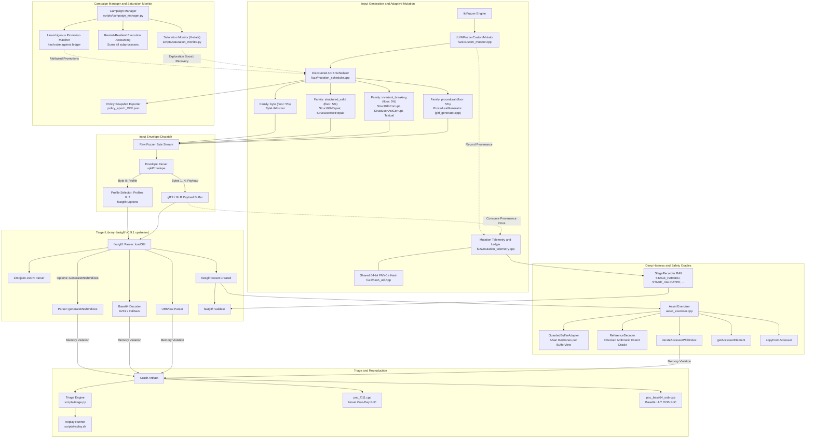

# QTFuzz: fastgltf Subsystem (Phase 1 Base Engine) (`src/fastgltf/`)

This directory contains the complete source code, mutation engines, safety oracles, fuzzing harnesses, adaptive schedulers, saturation monitors, automation scripts, raw experimental evaluation data, and vulnerability reproducers for the **fastgltf** subsystem of **QTFuzz**.

---

## 1. Project Metadata & Pinned Environment

All empirical results, coverage measurements, and vulnerability findings were generated using this pinned environment:

| Property | Value |
| :--- | :--- |
| **Target Library** | [fastgltf](https://github.com/spnda/fastgltf) |
| **Pinned Release** | `v0.9.1` |
| **Git Commit** | `705564d4d54500ae88befb0db9e361e447923655` (clean Git submodule in `external/fastgltf`) |
| **Target Architecture** | x86_64-pc-linux-gnu |
| **Operating System** | Linux 6.6 under WSL2 Ubuntu 24.04 LTS (Noble) |
| **Compiler Suite** | Clang version 18.1.3 (`clang`, `clang++`, `llvm-profdata`, `llvm-cov`) |
| **C++ Standard** | C++17 (`-std=c++17`) |
| **Build System** | CMake 3.28.3, Ninja 1.11.1 |
| **Fuzzing Engine** | LLVM libFuzzer |
| **Sanitizers** | AddressSanitizer (ASan) + UndefinedBehaviorSanitizer (UBSan) |

---

## 2. Research Hypothesis & Core Objectives

> **Under constrained fuzzing budgets, does a target-specific, structure-aware mutation engine equipped with a multi-armed bandit (Discounted-UCB) adaptive scheduler outperform static byte-level and fixed hybrid mutation in code coverage, deep parser stage penetration, and critical memory safety vulnerability discovery?**

### The Four Comparative Experimental Arms:
1. **`fixed` (Baseline):** Static 4-way hybrid schedule with fixed probability weights (25% byte, 25% valid structural, 40% invariant-breaking, 10% procedural) without dynamic adaptation or telemetry overhead.
2. **`adaptive`:** Dynamic multi-armed bandit scheduler using **Discounted Upper Confidence Bound (Discounted-UCB)** that updates family and sub-operator weights at epoch boundaries based on attributed corpus promotions, novel stage outcomes, and oracle findings.
3. **`fixed_with_saturation`:** Static 4-way baseline combined with a **6-state conservative saturation monitor** that halts execution or attempts plateau recovery when progress stagnates across multiple independent signals.
4. **`adaptive_with_saturation`:** Full adaptive architecture pairing the Discounted-UCB mutation scheduler with the conservative saturation monitor and plateau recovery sequence.

---

## 3. System Architecture

The architecture decouples container parsing, JSON AST mutation, dynamic operator scheduling, in-memory telemetry attribution, configuration profiling, and downstream accessor traversal into modular layers:



---

## 4. Mathematical and Algorithmic Formulation

### 4.1 Mutation Operator Registry
The mutator catalogs 8 specialized operators organized into 4 families with stable IDs:

| Family | ID | Operator Name | Description | Default Weight | Floor |
| :--- | :---: | :--- | :--- | :---: | :---: |
| **`byte`** | 0 | `ByteLibFuzzer` | Baseline `LLVMFuzzerMutate` fallback | 0.25 | 0.05 |
| **`structured_valid`** | 1 | `StructGlbRepair` | Binary GLB chunk mutation with container length repair | 0.125 | 0.02 |
| | 2 | `StructJsonAstRepair` | nlohmann::json DOM mutation with buffer length repair | 0.125 | 0.02 |
| **`invariant_breaking`** | 3 | `StructGlbCorrupt` | GLB header/chunk lengths and chunk alignment corruption | 0.14 | 0.02 |
| | 4 | `StructJsonAstCorrupt` | Accessor counts, bufferView offsets, and invalid types | 0.20 | 0.02 |
| | 5 | `StructJsonTextual` | Malformed numbers (`1e9999`), cut syntax, URI injection | 0.06 | 0.02 |
| **`procedural`** | 6 | `ProceduralGenerator` | Algorithmic synthesis of fresh glTF, GLB, and sparse assets | 0.10 | 0.02 |

### 4.2 Discounted-UCB Weight Adaptation
At each epoch boundary $e$, historical attempts $N_i$ and rewards $R_i$ are exponentially decayed by discount factor $\gamma \in (0, 1]$ (default $\gamma = 0.90$) to prioritize recent operational yield:
$$N_i^{(e)} = \gamma N_i^{(e-1)} + n_i^{(e)}, \qquad R_i^{(e)} = \gamma R_i^{(e-1)} + r_i^{(e)}$$

The UCB selection score combines exploitation (empirical mean yield) and exploration (uncertainty bonus with coefficient $c = 0.75$):
$$\text{score}_i = \frac{R_i}{N_i} + c \sqrt{\frac{\ln \sum_j N_j}{N_i}}$$

Reward accrual uses bounded, configurable weights with log-scaling to prevent high-throughput operators from dominating:
$$\text{raw\_reward} = w_{\text{promo}} \cdot \text{promotions} + w_{\text{stage}} \cdot \text{stages} + w_{\text{oracle}} \cdot \text{oracles} + w_{\text{crash}} \cdot \text{crashes}$$
$$r_i = \min\left(\ln(1 + \text{raw\_reward}),\; r_{\max} \cdot \max(1, n_i)\right)$$

### 4.3 Probability Normalization with Minimum Floors
To prevent arm starvation and ensure continuous exploration of the entire mutation spectrum, probabilities are normalized subject to strict floors ($f_{\text{fam}} = 0.05$, $f_{\text{op}} = 0.02$):
$$p_i = f + (1 - K \cdot f) \frac{\text{score}_i}{\sum_{j \in \text{enabled}} \text{score}_j}$$
Disabled arms receive exactly $p_i = 0.0$.

### 4.4 In-Memory Provenance Ledger & Replay Safety
To attribute corpus promotions unambiguously:
1. When `LLVMFuzzerCustomMutator` produces a payload, it computes the 64-bit FNV-1a hash and enqueues `(hash, size, operator, family, epoch)` into a bounded in-memory FIFO map.
2. When `LLVMFuzzerTestOneInput` receives bytes, it performs **single-consumption**: the record is matched, consumed, and erased from the pending queue. **Crucially, subsequent corpus replays never inherit stale attribution.**
3. Consumed records are logged into a retained `provenance_ledger` (`hash:size`).
4. At epoch completion, `campaign_manager.py` hashes newly retained corpus files and matches them against the ledger. Only unambiguous matches are credited; unmatched promotions are tracked separately.

### 4.5 Conservative Saturation State Machine
`saturation_monitor.py` implements a 6-state conservative controller to prevent premature stopping:
- **`ACTIVE`:** Steady progress detected via corpus promotions or feature delta.
- **`PLATEAU_SUSPECTED`:** 3 consecutive low-yield epochs observed.
- **`RECOVERY`:** Bounded rescue phase boosting exploration ($1.5\times$) and refreshing template seeds.
- **`SATURATED`:** Plateau persisted through recovery, minimum runtime (1800s) satisfied, telemetry complete, and zero un-triaged crash candidates pending.
- **`BUDGET_STOP`:** Hard total wall-time budget reached (distinct from saturation).
- **`ERROR`:** Missing or corrupted telemetry; fails safe without declaring saturation.

### 4.6 Multi-Subprocess Execution Accounting
In previous scripts, each trial was a restart loop where the reported execution count came from the *last* child process only. `campaign_manager.py` supervises libFuzzer with `-max_total_time` and **sums executions across ALL child invocations within an epoch**, providing completely accurate throughput and execution totals.

---

## 5. Target Hierarchy

- **`deep_fuzzer` (`fuzz/deep_fuzzer.cpp`):** Primary deep target. Decodes envelope profile byte, calls `Parser::loadGltf()`, executes validation, and traverses accessors with `GuardedBufferAdapter` and `ReferenceDecoder`.
- **`parser_fuzzer` (`fuzz/parser_fuzzer.cpp`):** Baseline target evaluating pure parser throughput without downstream accessor traversal.
- **`uri_fuzzer` (`fuzz/uri_fuzzer.cpp`):** Micro-target evaluating `fastgltf::URIView` RFC parsing, authorities, and percent-decoding.
- **`base64_fuzzer` (`fuzz/base64_fuzzer.cpp`):** Differential micro-target evaluating AVX2 SIMD vs fallback base64 decoders.
- **`coverage_runner` (`fuzz/coverage_runner.cpp`):** Non-fuzzing harness replaying corpus files for strict Clang source coverage mapping.

---

## 6. Directory Structure

```
src/
├── CMakeLists.txt                       # CMake build file (targets, ASan, UBSan, tests)
├── README.md                            # Comprehensive project guide (architecture, math, runs)
├── cmake/
│   └── coverage_allowlist.txt           # Restricts Clang coverage strictly to fastgltf & simdjson
├── corpus/
│   ├── gltf.dict                        # glTF 2.0 JSON dictionary for libFuzzer
│   ├── seed/                            # 43 base glTF and binary GLB seed files
│   └── generated/                       # Procedurally synthesized seed assets
├── docs/                                # Technical design documents
│   ├── accessor-preconditions.md        # Analysis of fastgltf accessor contract boundaries
│   ├── architecture.md                  # Harness and oracle architectural specification
│   ├── campaign_results.md              # Empirical campaign analysis and audit
│   ├── experiments.md                   # Experimental protocol and hypothesis design
│   ├── known_findings.md                # Known upstream issue classifications (Issue #144, #157)
│   └── mutations.md                     # Mutation strategies and boundary values specification
├── external/
│   └── fastgltf/                        # Git submodule pinned to upstream v0.9.1 (commit 705564d)
├── findings/                            # Campaign output, raw logs, and vulnerability reports
│   ├── index.csv                        # Primary triage catalog of unique crash root causes
│   ├── crashes/                         # Raw crash artifacts captured by libFuzzer
│   ├── reports/                         # Markdown vulnerability reports (FINDING-001 to 012)
│   └── trials/                          # Historical experimental trials
├── fuzz/                                # Fuzz harnesses, custom mutators, and schedulers
│   ├── asset_exerciser.cpp / .hpp       # Type-dispatched accessor iteration engine
│   ├── base64_fuzzer.cpp                # Base64 SIMD differential micro-target
│   ├── coverage_runner.cpp              # Corpus coverage replay runner
│   ├── custom_mutator.cpp / .hpp        # Hybrid mutator with dynamic scheduler dispatch
│   ├── deep_fuzzer.cpp                  # Primary deep fuzz target with stage recording
│   ├── fuzz_common.hpp                  # Envelope parsing (splitEnvelope) and 8 profiles
│   ├── glb_parser.cpp / .hpp            # Binary GLB container chunk unpacker/repacker
│   ├── guarded_buffer_adapter.cpp/.hpp  # Isolated bufferView allocator with ASan redzones
│   ├── hash_util.hpp                    # Shared 64-bit FNV-1a content hash
│   ├── mutation_scheduler.cpp / .hpp    # Discounted-UCB scheduler and Operator Registry
│   ├── mutation_telemetry.cpp / .hpp    # In-memory FIFO provenance map and stage recorder
│   ├── parser_fuzzer.cpp                # Baseline parser target
│   ├── reference_decoder.cpp / .hpp     # Checked integer arithmetic accessor extent oracle
│   ├── telemetry.cpp / .hpp             # Execution, rejection, and violation telemetry
│   └── uri_fuzzer.cpp                   # URIView RFC parsing micro-target
├── generator/
│   └── gltf_generator.cpp / .hpp        # Procedural mesh, box, and sparse glTF/GLB seed generator
├── poc_f011.cpp                         # Standalone C++ PoC for Novel Zero-Day F011
├── poc_base64_oob.cpp                   # Standalone C++ PoC for Novel Base64 LUT OOB
├── scripts/                             # Automation scripts
│   ├── build.sh                         # Multi-target CMake build driver
│   ├── campaign.sh                      # Multi-trial bash campaign runner
│   ├── campaign_manager.py              # Supervised epoch runner & UCB policy updater
│   ├── campaign_policy.example.json     # Campaign configuration schema
│   ├── coverage.sh                      # llvm-profdata and llvm-cov report generator
│   ├── evaluate_campaign.py             # Campaign data processing and statistical audit
│   ├── fuzz.sh                          # Single fuzzer invocation wrapper
│   ├── merge_corpus.sh                  # Corpus distillation and minimization
│   ├── minimize.sh                      # libFuzzer crash minimization wrapper
│   ├── prepare_seeds.py                 # Algorithmic seed corpus generator
│   ├── replay.sh                        # Standalone crash reproducer
│   ├── saturation_monitor.py            # 6-state conservative saturation monitor
│   ├── test_adaptive_fuzzer.py          # Python test suite for scheduler & saturation
│   ├── triage.py                        # Symbolized crash stack triage & dedup
│   ├── triage.sh                        # Triage shell wrapper
│   └── validate.sh                      # Environment and dependency verification
└── tests/                               # Standalone C++ unit test suites
    ├── adapter_tests.cpp                # GuardedBufferDataAdapter bounds tests
    ├── base64_tests.cpp                 # Base64 SIMD vs fallback parity tests
    ├── generator_tests.cpp              # Procedural generator validation tests
    ├── glb_tests.cpp                    # Binary GLB roundtrip and repair tests
    ├── mutator_tests.cpp                # Custom mutator deterministic tests
    ├── scheduler_tests.cpp              # Discounted-UCB, FNV-1a vectors, and provenance tests
    └── uri_tests.cpp                    # URIView RFC parsing tests
```

---

## 7. Build and Verification Instructions

All commands are executed from the `src/` directory in a WSL2 Ubuntu or Linux environment:

### Step 1: Build Targets with Sanitizers
```bash
cd src

# Build all fuzz targets and unit tests with Clang 18.1.3 + ASan + UBSan
./scripts/build.sh asan
```

### Step 2: Run C++ Unit Test Suites
```bash
cd build-asan
./scheduler_tests    # Verifies FNV-1a vectors, UCB math, floors, and provenance consumption
./mutator_tests      # Verifies mutator determinism and bounds safety
./glb_tests          # Verifies GLB chunk unpacker and structural repair
./base64_tests       # Verifies AVX2 SIMD and fallback parity
./adapter_tests      # Verifies ASan redzones and bounds checking
./generator_tests    # Verifies procedural generator validity
./uri_tests          # Verifies URIView RFC parsing
cd ..
```

### Step 3: Run Python Unit Test Suite
```bash
python3 scripts/test_adaptive_fuzzer.py
```
This runs 8 unit test suites verifying:
- Shared 64-bit FNV-1a test vectors matching C++ (`hash_util.hpp`)
- Probability normalization with minimum floors and disabled arm handling
- Discounted-UCB reward accrual, decay, and exploration bonus
- Multi-subprocess log parsing and restart-resilient execution accounting
- Robustness against malformed or truncated logs
- Exact corpus promotion matching against the provenance ledger
- 6-state saturation monitor state transitions and recovery sequences
- Fixed baseline (25/25/40/10) preservation

---

## 8. Running Campaigns Across the 4 Comparative Modes

The campaign manager (`scripts/campaign_manager.py`) coordinates epoch execution, child process supervision, telemetry collection, and report generation:

```bash
# Mode 1: Baseline Fixed Schedule (25/25/40/10)
python3 scripts/campaign_manager.py \
  --mode fixed \
  --target deep_fuzzer \
  --output-dir findings/campaign_fixed \
  --epoch-seconds 300 \
  --hard-max-seconds 7200

# Mode 2: Dynamic Discounted-UCB Adaptive Fuzzer
python3 scripts/campaign_manager.py \
  --mode adaptive \
  --target deep_fuzzer \
  --output-dir findings/campaign_adaptive \
  --epoch-seconds 300 \
  --hard-max-seconds 7200

# Mode 3: Fixed Baseline with Conservative Saturation Monitor
python3 scripts/campaign_manager.py \
  --mode fixed_with_saturation \
  --target deep_fuzzer \
  --output-dir findings/campaign_fixed_sat \
  --epoch-seconds 300 \
  --hard-max-seconds 7200

# Mode 4: Full Adaptive Hybrid Fuzzer with Saturation Monitor
python3 scripts/campaign_manager.py \
  --mode adaptive_with_saturation \
  --target deep_fuzzer \
  --output-dir findings/campaign_adaptive_sat \
  --epoch-seconds 300 \
  --hard-max-seconds 7200
```

### Campaign Output Deliverables:
Every campaign output directory contains:
- `config_used.json`: Complete configuration used.
- `policy_epoch_XXX.json`: Serialized scheduler weights for each epoch.
- `epoch_XXX.log`: Raw stdout/stderr logs from all subprocesses within the epoch.
- `epoch_XXX_metrics.json`: Detailed executions, restarts, coverage, promotions, and stage outcomes.
- `epoch_XXX_telemetry.json`: In-memory telemetry snapshot and provenance ledger.
- `corpus_manifest.json`: Snapshot of all corpus seeds with FNV-1a hashes, sizes, and operator attribution.
- `findings/crashes/`: Captured crash artifacts.
- `campaign_summary.json`: Complete machine-readable campaign metrics and saturation decision logs.
- `campaign_report.md`: Formatted Markdown report with epoch progression tables.

---

## 9. Reproducing Discovered Vulnerabilities

### Novel Zero-Day F011: Heap Out-of-Bounds Read in `Parser::generateMeshIndices`
```bash
# Compile standalone proof-of-concept
clang++ -std=c++17 -fsanitize=address,undefined -g -O0 \
  -Iexternal/fastgltf/include poc_f011.cpp \
  -Lbuild-asan/external/fastgltf -lfastgltf -o poc_f011

# Trigger vulnerability with minimized crash artifact
./poc_f011 findings/crashes/crash-db0170fae561bcc1186860580e462803e93ecac1
```

### Novel Finding: Base64 Lookup Table Out-of-Bounds Read
```bash
clang++ -std=c++17 -fsanitize=address,undefined -g -O0 \
  -Iexternal/fastgltf/include poc_base64_oob.cpp \
  -Lbuild-asan/external/fastgltf -lfastgltf -o poc_base64_oob

./poc_base64_oob findings/crashes/crash-9ea971d643fe14c0048d3bc354cb432e185ae144
```
