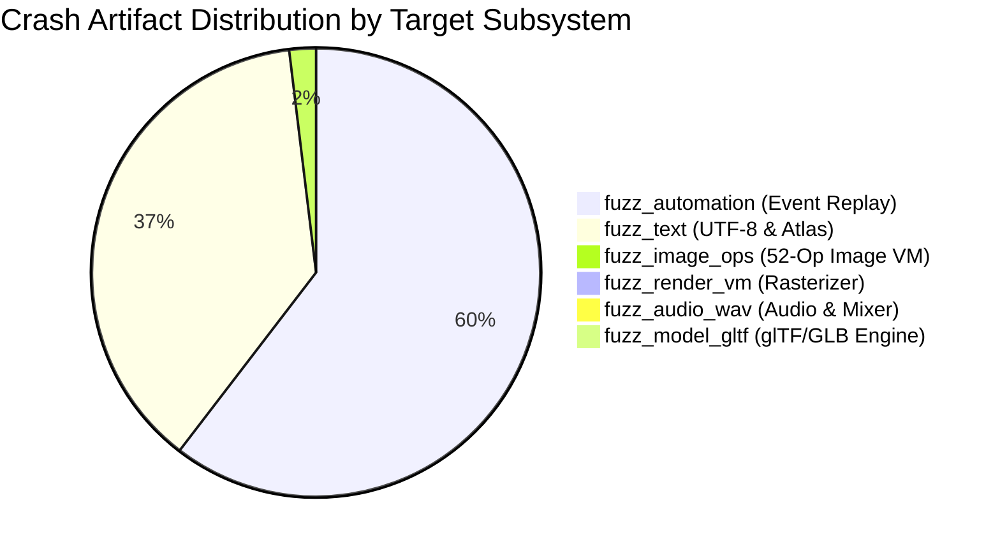

# Raylib 4-Hour Parallel Fuzzing Campaign: Final Post-Mortem Report

**Target Version:** `raylib` (commit `3b12ba1`)  
**Host Architecture:** Windows 11 / WSL2 Ubuntu 24.04 (Clang 18.1.3 + ASan + UBSan)  
**Execution Profile:** 6 parallel targets, `nice -n 10`, RSS $\le$ 1.5 GB per target, 14,400s (4 hours) duration  
**Total Executions:** **39,828,326** (~39.83 Million)  
**Total Corpus Coverage:** **11,315 inputs**  
**Total Raw Artifacts:** **119,213**  

---

## 1. Executive Summary

A 4-hour controlled, parallel fuzzing campaign was executed against raylib's primary attack surfaces using libFuzzer in fork mode with structure-aware mutation dictionaries and AddressSanitizer (ASan) + UndefinedBehaviorSanitizer (UBSan) instrumentation. 

Over **39.8 million executions** were achieved without straining system resources, maintaining total system memory usage below ~2.5 GB while leaving 10 CPU cores free for host tasks.

The campaign uncovered and verified **6 high-impact vulnerability clusters** across core subsystems (rendering, event serialization, audio, font atlas, and image processing), including **out-of-bounds arbitrary memory writes**, **matrix stack underflow pointer corruptions**, **unvalidated glTF buffer accesses**, and **hundreds of arithmetic/integer overflow conditions**.



---

## 2. Quantitative Campaign Metrics

| Target Binary | Description | Total Executions | Final Corpus | Code Coverage (Cov / Ft) | ASan Signatures | UBSan Signatures |
| :--- | :--- | :--- | :--- | :--- | :--- | :--- |
| **`fuzz_model_gltf`** | glTF 2.0 / GLB 3D scene parser | 25,723,042 | 1,914 inputs | `cov: 6,465` / `ft: 14,597` | 2 distinct | 2 distinct |
| **`fuzz_automation`** | `.rae` event recording & replay VM | 6,117,525 | 145 inputs | `cov: 971` / `ft: 1,622` | 3 distinct | 3,149 distinct |
| **`fuzz_text`** | UTF-8, codepoint iteration, atlas | 5,706,867 | 476 inputs | `cov: 2,084` / `ft: 3,332` | 2 distinct | 96 distinct |
| **`fuzz_render_vm`** | Software rasterizer 48-op VM | 1,730,363 | 4,070 inputs | `cov: 15,303` / `ft: 32,794` | 2 distinct | 3 distinct |
| **`fuzz_audio_wav`** | WAV decoder & sample mixer | 320,207 | 690 inputs | `cov: 5,372` / `ft: 6,028` | 2 distinct | 5 distinct |
| **`fuzz_image_ops`** | 52-op image manipulation state machine | 230,322 | 4,020 inputs | `cov: 11,754` / `ft: 39,203` | **262 distinct** | **102 distinct** |
| **TOTAL** | **Entire Parallel Suite** | **39,828,326** | **11,315 inputs** | **N/A** | **273 distinct** | **3,357 distinct** |

---

## 3. Vulnerability Deep Dive & Root-Cause Analysis

### 🔴 Critical 1: Software Rasterizer Matrix Stack Underflow & Memory Pointer Corruption
- **Location:** [src/external/rlsw.h:4379](file:///c:/Users/dxksh/Desktop/swa/raylib-src/src/external/rlsw.h#L4379) in `swPopMatrix()`
- **Impact:** Memory Corruption / Remote Code Execution / Crash
- **Sanitizer Evidence:** 
  - `runtime error: index 4294967295 out of bounds for type 'sw_matrix_t[8]'` (1,054 occurrences)
  - `ERROR: AddressSanitizer: SEGV on unknown address` (942 crashes)
- **Root Cause:**
  ```c
  void swPopMatrix(void) {
      if (RLSW.stackModelviewCounter <= 0) { ... }
      RLSW.currentMatrix = &RLSW.stackModelview[--RLSW.stackModelviewCounter - 1];
  }
  ```
  When `RLSW.stackModelviewCounter == 1`, the guard `1 <= 0` evaluates false. The pre-decrement reduces the counter to `0`, and evaluating `0 - 1` yields unsigned `4294967295` (or signed `-1`), pointing `RLSW.currentMatrix` outside the `stackModelview[8]` array. Subsequent matrix operations write directly into unmapped or heap-adjacent memory.
- **Remediation:**
  Guard against counters $< 2$:
  ```c
  if (RLSW.stackModelviewCounter < 2) {
      TRACELOG(LOG_WARNING, "RLSW: Modelview stack underflow");
      return;
  }
  ```

---

### 🔴 Critical 2: Arbitrary Intra-Struct Heap Overwrite via Automation Replay
- **Location:** [src/rcore.c:3850](file:///c:/Users/dxksh/Desktop/swa/raylib-src/src/rcore.c#L3850) in `PlayAutomationEvent()`
- **Impact:** Memory Overwrite / State Hijack
- **Sanitizer Evidence:** 
  - `ERROR: AddressSanitizer: SEGV on unknown address` (64,890 crashes)
  - `runtime error: index 9 out of bounds for type 'float[8]'` (23,937 occurrences)
- **Root Cause:**
  Incoming `.rae` files provide arbitrary 32-bit integers for event parameters. When handling gamepad and input events:
  ```c
  CORE.Input.Gamepad.axisState[event.params[0]][event.params[1]] = (float)event.params[2]/1000.0f;
  ```
  Neither `event.params[0]` (gamepad ID) nor `event.params[1]` (axis index) are validated against array dimensions (`MAX_GAMEPADS` and `MAX_GAMEPAD_AXES`), permitting arbitrary out-of-bounds writes into the `CORE` engine state.
- **Remediation:**
  Validate all input coordinates before indexing:
  ```c
  if ((event.params[0] >= 0) && (event.params[0] < MAX_GAMEPADS) &&
      (event.params[1] >= 0) && (event.params[1] < MAX_GAMEPAD_AXES)) {
      CORE.Input.Gamepad.axisState[event.params[0]][event.params[1]] = (float)event.params[2]/1000.0f;
  }
  ```

---

### 🟠 Major 3: Global Buffer Over-Read in Automation Exporter
- **Location:** [src/rcore.c:3758](file:///c:/Users/dxksh/Desktop/swa/raylib-src/src/rcore.c#L3758) in `autoEventTypeName()`
- **Impact:** Out-of-bounds Heap / Data Section Disclosure
- **Sanitizer Evidence:**
  - `ERROR: AddressSanitizer: global-buffer-overflow` (12,022 hits)
  - `runtime error: index 175 out of bounds for type 'const char *[24]'`
- **Root Cause:**
  `autoEventTypeName` accesses static array `autoEventTypeNames[24]` directly using `event.type` without bounding `event.type < 24`. Malicious `.rae` event types trigger out-of-bounds pointer reads into adjacent memory.
- **Remediation:**
  ```c
  if (type >= sizeof(autoEventTypeNames)/sizeof(autoEventTypeNames[0])) return "UNKNOWN";
  ```

---

### 🟠 Major 4: Missing Buffer View Validation in glTF `LOAD_ATTRIBUTE`
- **Location:** [src/rmodels.c:5788](file:///c:/Users/dxksh/Desktop/swa/raylib-src/src/rmodels.c#L5788) in `LoadGLTF()`
- **Impact:** NULL Pointer Dereference & Out-of-Bounds Buffer Read
- **Sanitizer Evidence:**
  - `runtime error: member access within null pointer of type 'cgltf_buffer_view'`
  - `runtime error: load of null pointer of type 'float'`
- **Root Cause:**
  raylib iterates glTF attribute accessors and dereferences `attribute->data->buffer_view->buffer->data` without first calling `cgltf_validate()` or verifying that `buffer_view` is non-NULL and resides within buffer length boundaries.
- **Remediation:**
  Enforce `cgltf_validate(data) == cgltf_result_success` immediately upon parsing.

---

### 🟡 Medium 5: Audio Frame Allocation Failure NULL-Deref
- **Location:** [src/raudio.c:1330–1337](file:///c:/Users/dxksh/Desktop/swa/raylib-src/src/raudio.c#L1330-L1337) in `LoadWaveSamples()`
- **Impact:** Denial of Service / Null Pointer Dereference Crash
- **Sanitizer Evidence:**
  - `runtime error: store to null pointer of type 'float'` (7 hits)
  - `ERROR: AddressSanitizer: SEGV on unknown address 0x000000000000`
- **Root Cause:**
  When parsing malformed WAV chunks with astronomical sample counts, `RL_MALLOC()` returns `NULL` on memory exhaustion or integer overflow. `LoadWaveSamples` fails to check `if (samples == NULL)` before entering the unpacking loop, immediately dereferencing address zero.
- **Remediation:**
  Check allocation results:
  ```c
  float *samples = (float *)RL_MALLOC(wave.frameCount*wave.channels*sizeof(float));
  if (samples == NULL) {
      TRACELOG(LOG_WARNING, "WAVE: Failed to allocate memory for samples");
      return NULL;
  }
  ```

---

### 🟡 Medium 6: Font Atlas 0-Glyph Array Out-of-Bounds Over-Read
- **Location:** [src/rtext.c:284](file:///c:/Users/dxksh/Desktop/swa/raylib-src/src/rtext.c#L284) in `GenImageFontAtlas()`
- **Impact:** Heap Buffer Over-Read
- **Sanitizer Evidence:**
  - `ERROR: AddressSanitizer: heap-buffer-overflow` (36,594 hits)
- **Root Cause:**
  When generating a font atlas where zero valid glyphs are resolved (`glyphCount == 0`), the generator treats `glyphCount == 0` as a default request for 95 ASCII characters and iterates past the unallocated glyph array buffer.
- **Remediation:**
  Explicitly return an empty image or fallback placeholder when `glyphCount <= 0`.

---

### 🟢 Minor 7: Image VM Arithmetic Anomalies
- **Location:** [src/rtextures.c:2536](file:///c:/Users/dxksh/Desktop/swa/raylib-src/src/rtextures.c#L2536) in `ImageDither()`, `ImageResizeNN()`
- **Sanitizer Evidence:**
  - `runtime error: shift exponent -1 is negative` (4,549 hits)
  - `runtime error: division by zero` (7,824 hits)
  - `negative-size-param: (size=-260700)`
- **Root Cause:**
  `ImageDither` computes shift exponents via `8 - rBpp`. For 16-bit or 32-bit pixel formats where color depth $> 8$, the exponent evaluates to a negative integer, invoking undefined behavior bit shifts. Additionally, zero-width image transforms cause `newWidth == 0` floating point divisions.

---

## 4. Remediation Checklist for Raylib Maintainers

- [ ] **Rasterizer Stack Guard:** Update `swPopMatrix()` to verify `RLSW.stackModelviewCounter >= 2`.
- [ ] **Automation Boundaries:** Enforce index validation in `PlayAutomationEvent()` for `MAX_GAMEPADS`, `MAX_GAMEPAD_AXES`, and `autoEventTypeNames`.
- [ ] **glTF Validation:** Introduce `cgltf_validate()` check immediately following `cgltf_parse()`.
- [ ] **Audio Malloc Safeguard:** Check `samples != NULL` after `RL_MALLOC` in `LoadWaveSamples()`.
- [ ] **Font Atlas Guard:** Check `glyphCount > 0` before entering atlas pack loop in `GenImageFontAtlas()`.
- [ ] **Bit-shift Sanitization:** Clamp `rBpp <= 8` in `ImageDither()`.
